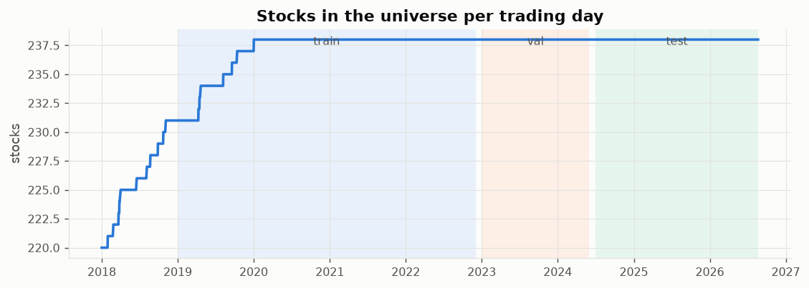
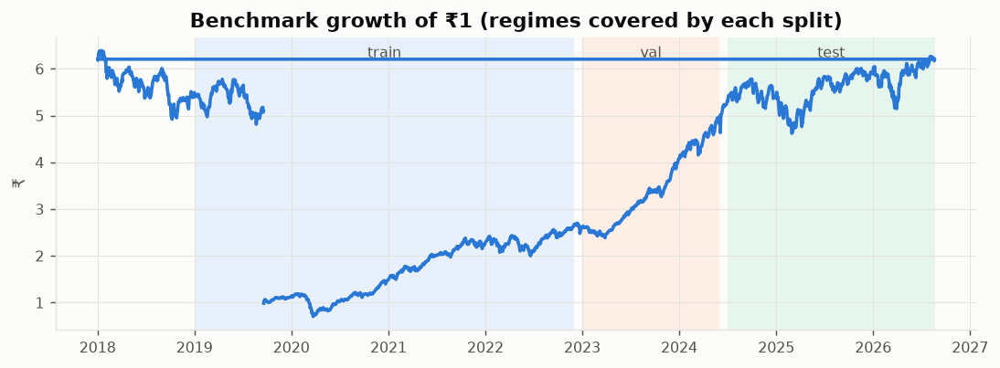
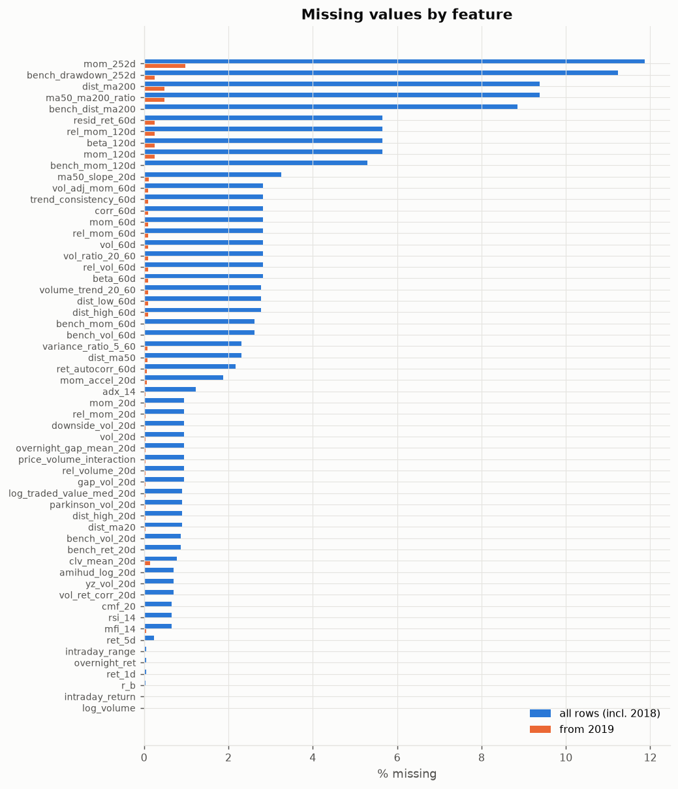
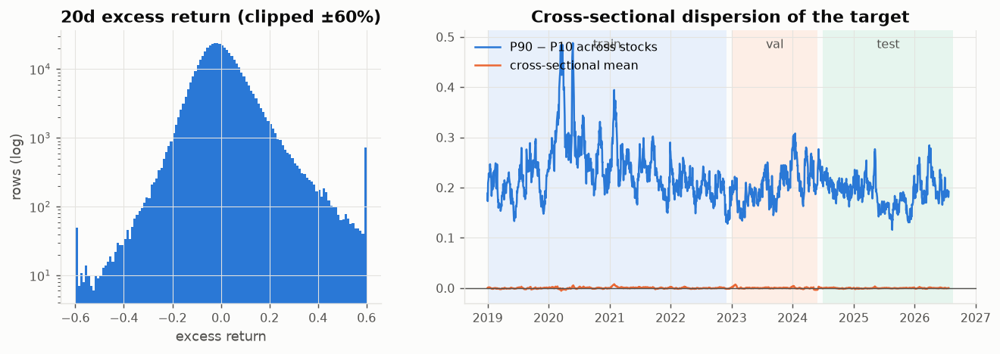
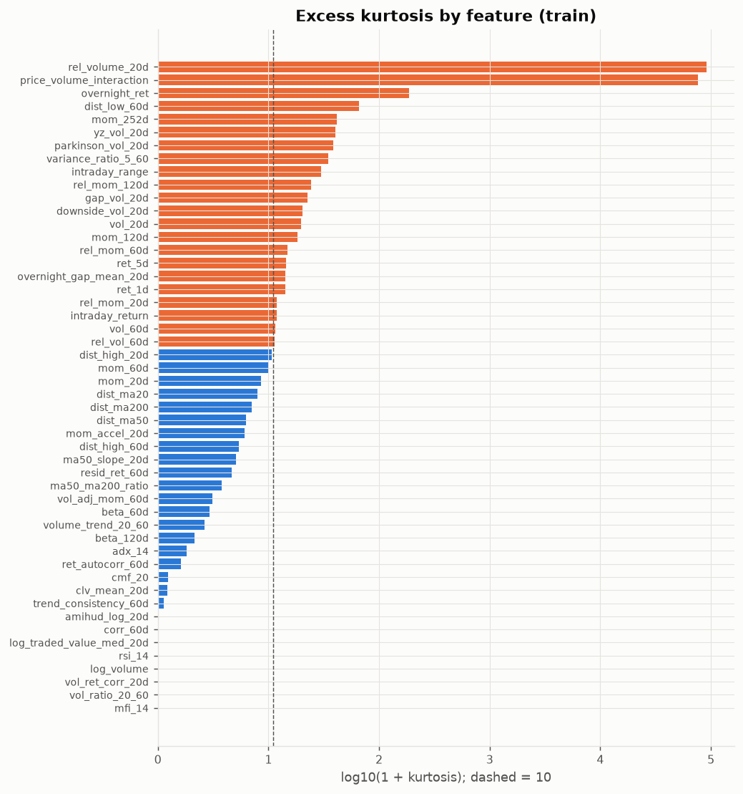
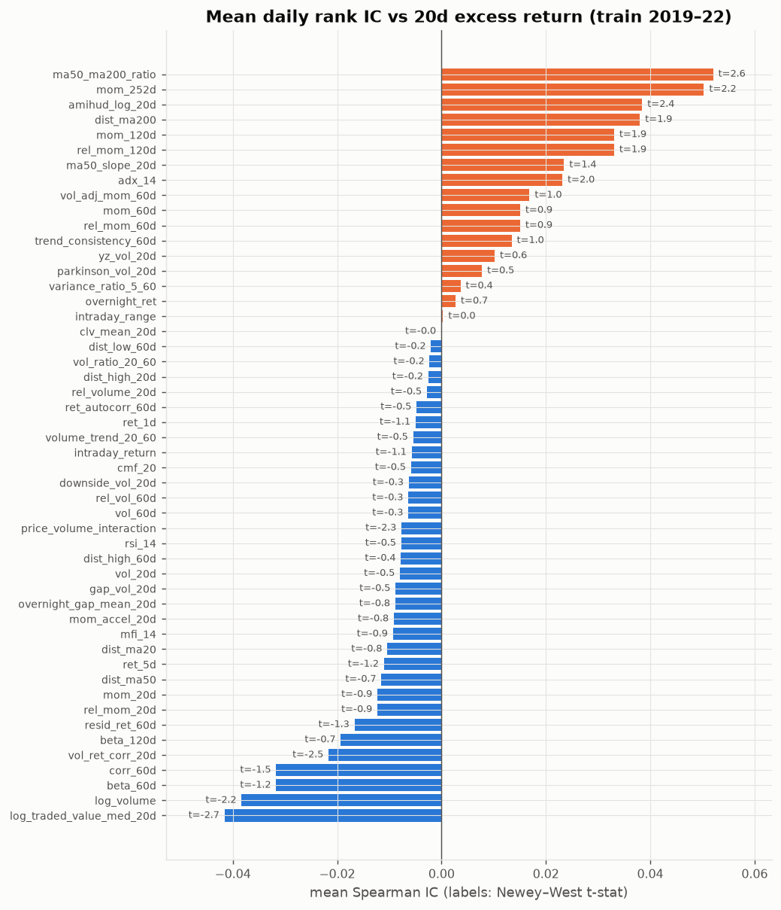
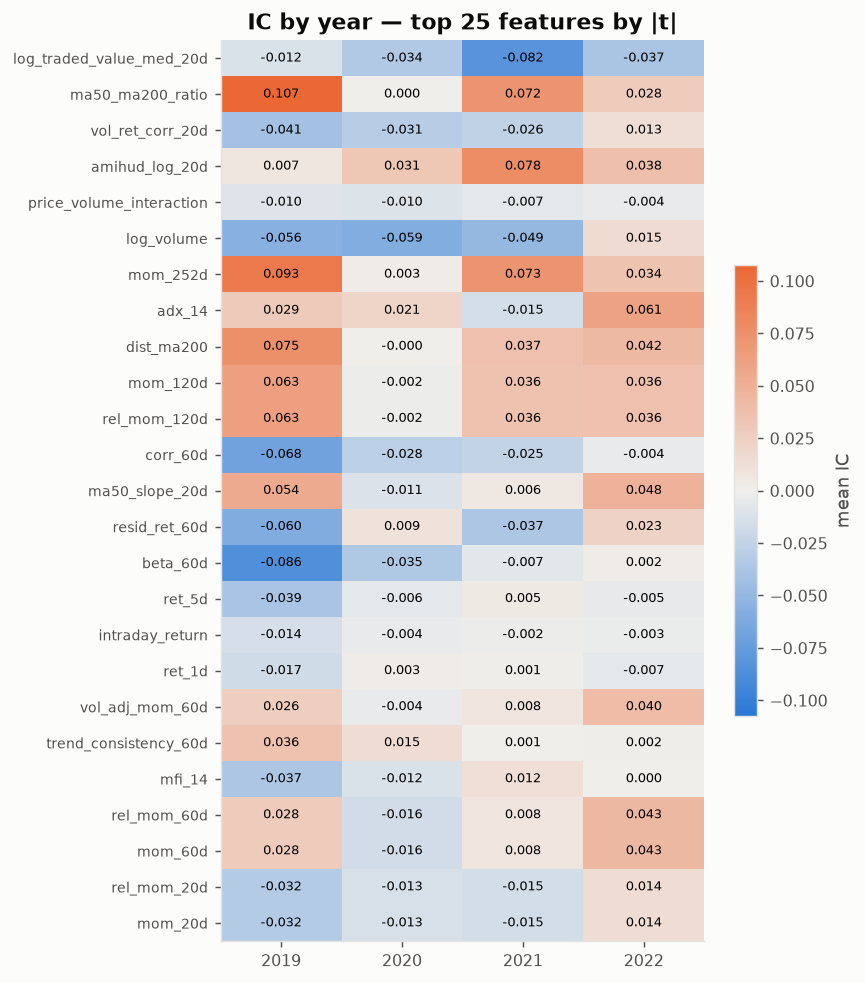
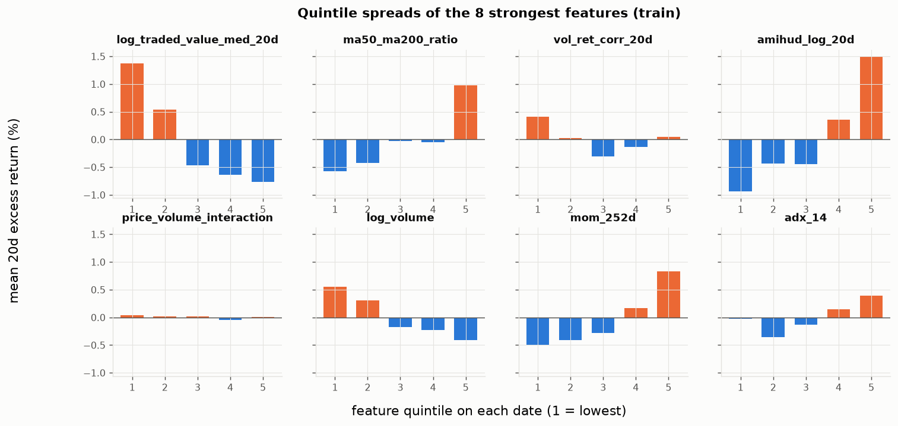
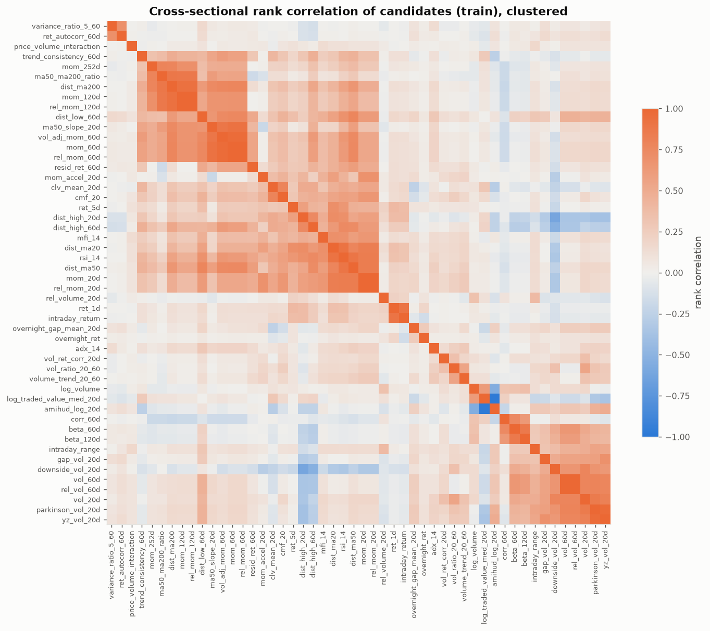

# 00 — Shared data audit and EDA

Source: `features_by_stock.xlsx` (238 sheets, one per stock; Bloomberg OHLCV + engineered features).
Panel: **505,146 rows**, **238 stocks**, 2018-01-01 → 2026-08-21, 2,139 trading days.

## Integrity checks

| check | value |
|---|---|
| duplicate (Symbol, Date) keys | 0 |
| max |target - (fwd_ret_20d - bench_fwd_ret)| | 8.882e-16 |
| max |fwd_ret_20d(t) - mom_20d(t+20)| | 0 |
| max |candle_body - intraday_return| | 2.22e-16 |
| max |rel_mom_20d - (mom_20d - bench_ret_20d)| | 8.882e-16 |
| max per-date unique values of r_b (market col) | 1 |
| rows with Volume == 0 | 9 |
| rows with High == Low (locked / no range) | 576 |
| rows with |ret_1d| > 35% (corporate action or crash) | 14 |
| VWAP missing share | 0.2231 |
| weekend sessions (Muhurat / Budget days) | 9 |

Conclusions:
- `target_excess_ret_20d = fwd_ret_20d − bench_fwd_ret` exactly, and `fwd_ret_20d(t) = mom_20d(t+20)`: the target is the **simple 20-trading-day forward return in excess of the benchmark**, measured close t → close t+20.
- `fwd_ret_20d`, `bench_fwd_ret`, `target_*` are future information → **excluded from every feature set**.
- `candle_body` is an exact copy of `intraday_return` → dropped.
- `rel_mom_k = mom_k − bench_ret_k`: inside one date they differ by a constant, so for a cross-sectional ranking model they are the same feature (rank correlation = 1).
- The 8 `bench_*`/`r_b` columns are identical across stocks on a date (market regime). They cannot rank stocks by themselves; trees/RNNs may use them as regime conditioners, linear models drop them.
- `rank_*` columns are per-date ranks of columns we already have → superseded by our own cross-sectional transforms.
- VWAP is missing for all of 2018–2019 → not used.
- A handful of |daily return| > 35% moves are unadjusted demergers (e.g. Siemens 2025-04-07, Tata Motors 2025-10-14) or genuine crashes (Yes Bank 2020). They contaminate momentum features and targets for those names, which is why every model winsorizes features cross-sectionally (1/99%) and trains on a winsorized target.
- Rows with zero volume or High = Low are flagged `tradable = False` (excluded from the selectable universe in the backtest).
- Survivorship: the universe is today's 238 names back-filled to 2018 (8 names list later). Results will be optimistic vs a point-in-time index membership.

## Splits (shared by all models)

Train 2019-01-01 → 2022-12-31; validation 2023-01-01 → 2024-06-30; test 2024-07-01 → end. 2018 is burn-in (1-year lookbacks). The 20 trading days before validation and before test are **purged** so no target window crosses a boundary. The last 20 days have no target (live prediction rows).

| split   |   rows |   dates | first               | last                |
|:--------|-------:|--------:|:--------------------|:--------------------|
| burn_in |  55579 |     246 | 2018-01-01 00:00:00 | 2018-12-31 00:00:00 |
| purge   |   9520 |      40 | 2022-12-05 00:00:00 | 2024-06-28 00:00:00 |
| test    | 126854 |     533 | 2024-07-01 00:00:00 | 2026-08-21 00:00:00 |
| train   | 230131 |     971 | 2019-01-01 00:00:00 | 2022-12-02 00:00:00 |
| val     |  83062 |     349 | 2023-01-02 00:00:00 | 2024-05-30 00:00:00 |

## Extra features added from `statarb_features_ranked.pdf`

The file did not contain several single-stock Tier-2/3 features from the PDF; these were computed causally from OHLCV: `amihud_log_20d`, `yz_vol_20d`, `variance_ratio_5_60`, `ret_autocorr_60d`, `overnight_ret`, `vol_ret_corr_20d`, `rsi_14`, `adx_14`, `mfi_14`, `cmf_20`. Pair-trading features (spread, hedge ratio, cointegration, half-life, OU) are not applicable to this cross-sectional stock-ranking design; the factor-residual idea is already represented by `resid_ret_60d`.

## Missing values

Missingness is almost entirely the lookback warm-up (up to 252 days) plus late listings. After the 2018 burn-in the worst feature is `mom_252d` at 1.0%.

## Target

|                       |       count |   mean |    std |     min |      1% |      5% |     50% |    95% |    99% |    max |   skew |   kurtosis |
|:----------------------|------------:|-------:|-------:|--------:|--------:|--------:|--------:|-------:|-------:|-------:|-------:|-----------:|
| target_excess_ret_20d | 444807.0000 | 0.0001 | 0.1011 | -0.7426 | -0.2106 | -0.1350 | -0.0095 | 0.1642 | 0.3224 | 1.8321 | 1.5096 |    10.5862 |

Heavy tails (kurtosis above) → models are trained on a cross-sectionally winsorized copy; the raw target is kept for evaluation.
Targets overlap 19 of 20 days between consecutive dates, so naive t-stats are inflated; all IC t-stats here use Newey–West with 20 lags.

## Feature distributions

22 of 50 candidates have excess kurtosis > 10 (orange) → cross-sectional winsorization / ranking is required.

## Univariate predictive power (train only)

Daily Spearman rank IC between each feature and the 20d excess return, averaged over 2019–2022.

| feature                  |   ic_mean |   ic_tstat_nw |   icir_ann |   hit_rate |   year_sign_stability |   pdf_tier |   na_after_burn_in |
|:-------------------------|----------:|--------------:|-----------:|-----------:|----------------------:|-----------:|-------------------:|
| log_traded_value_med_20d |   -0.0416 |       -2.6842 |    -1.0675 |     0.5644 |                1.0000 |     4.0000 |             0.0003 |
| ma50_ma200_ratio         |    0.0520 |        2.5627 |     1.0535 |     0.6437 |                1.0000 |     4.0000 |             0.0048 |
| vol_ret_corr_20d         |   -0.0217 |       -2.4867 |    -0.9159 |     0.6025 |                0.7500 |     3.0000 |             0.0002 |
| amihud_log_20d           |    0.0384 |        2.3552 |     0.9301 |     0.5602 |                1.0000 |     2.0000 |             0.0002 |
| price_volume_interaction |   -0.0077 |       -2.2827 |    -0.3367 |     0.5396 |                1.0000 |     3.0000 |             0.0003 |
| log_volume               |   -0.0383 |       -2.2072 |    -0.9473 |     0.5881 |                0.7500 |     4.0000 |             0.0000 |
| mom_252d                 |    0.0503 |        2.1826 |     0.8978 |     0.6272 |                1.0000 |     3.0000 |             0.0098 |
| adx_14                   |    0.0232 |        1.9724 |     0.7818 |     0.5942 |                0.7500 |     3.0000 |             0.0004 |
| dist_ma200               |    0.0380 |        1.9041 |     0.7718 |     0.6138 |                0.7500 |     2.0000 |             0.0048 |
| mom_120d                 |    0.0331 |        1.8757 |     0.7351 |     0.6117 |                0.7500 |     3.0000 |             0.0025 |
| rel_mom_120d             |    0.0331 |        1.8757 |     0.7351 |     0.6117 |                0.7500 |     2.0000 |             0.0025 |
| corr_60d                 |   -0.0317 |       -1.5390 |    -0.6460 |     0.5633 |                1.0000 |     2.0000 |             0.0010 |
| ma50_slope_20d           |    0.0235 |        1.4140 |     0.5616 |     0.6066 |                0.7500 |     4.0000 |             0.0012 |
| resid_ret_60d            |   -0.0167 |       -1.3283 |    -0.5286 |     0.5530 |                0.5000 |     1.0000 |             0.0025 |
| beta_60d                 |   -0.0317 |       -1.2414 |    -0.5185 |     0.5345 |                0.7500 |     2.0000 |             0.0010 |
| ret_5d                   |   -0.0110 |       -1.1767 |    -0.3152 |     0.5541 |                0.7500 |     3.0000 |             0.0001 |
| intraday_return          |   -0.0057 |       -1.1302 |    -0.1895 |     0.5252 |                1.0000 |     3.0000 |             0.0000 |
| ret_1d                   |   -0.0050 |       -1.0517 |    -0.1594 |     0.5252 |                0.5000 |     2.0000 |             0.0000 |
| vol_adj_mom_60d          |    0.0169 |        1.0484 |     0.4154 |     0.5963 |                0.7500 |     3.0000 |             0.0010 |
| trend_consistency_60d    |    0.0134 |        1.0028 |     0.4041 |     0.5695 |                1.0000 |     4.0000 |             0.0010 |
| mfi_14                   |   -0.0093 |       -0.9479 |    -0.3139 |     0.5345 |                0.5000 |     3.0000 |             0.0006 |
| rel_mom_60d              |    0.0151 |        0.9328 |     0.3667 |     0.5932 |                0.7500 |     2.0000 |             0.0010 |
| mom_60d                  |    0.0151 |        0.9328 |     0.3667 |     0.5932 |                0.7500 |     3.0000 |             0.0010 |
| rel_mom_20d              |   -0.0123 |       -0.8832 |    -0.3231 |     0.5005 |                0.7500 |     2.0000 |             0.0003 |
| mom_20d                  |   -0.0123 |       -0.8832 |    -0.3231 |     0.5005 |                0.7500 |     3.0000 |             0.0003 |
| overnight_gap_mean_20d   |   -0.0089 |       -0.8272 |    -0.2893 |     0.5530 |                0.7500 |     3.0000 |             0.0003 |
| dist_ma20                |   -0.0104 |       -0.7984 |    -0.2793 |     0.5335 |                0.5000 |     2.0000 |             0.0003 |
| mom_accel_20d            |   -0.0091 |       -0.7930 |    -0.2551 |     0.5170 |                0.5000 |     2.0000 |             0.0006 |
| dist_ma50                |   -0.0115 |       -0.7291 |    -0.2876 |     0.5201 |                0.7500 |     2.0000 |             0.0008 |
| beta_120d                |   -0.0193 |       -0.6923 |    -0.2933 |     0.5283 |                0.5000 |     2.0000 |             0.0025 |
| overnight_ret            |    0.0027 |        0.6743 |     0.1002 |     0.5129 |                0.5000 |     3.0000 |             0.0000 |
| yz_vol_20d               |    0.0102 |        0.5850 |     0.2322 |     0.5252 |                0.5000 |     2.0000 |             0.0002 |
| rsi_14                   |   -0.0077 |       -0.5452 |    -0.2041 |     0.4995 |                0.7500 |     2.0000 |             0.0002 |
| gap_vol_20d              |   -0.0088 |       -0.5354 |    -0.2195 |     0.5170 |                0.5000 |     3.0000 |             0.0003 |
| rel_volume_20d           |   -0.0028 |       -0.5268 |    -0.1125 |     0.5283 |                1.0000 |     2.0000 |             0.0003 |
| vol_20d                  |   -0.0080 |       -0.5255 |    -0.2047 |     0.5118 |                0.5000 |     2.0000 |             0.0003 |
| volume_trend_20_60       |   -0.0054 |       -0.5012 |    -0.1859 |     0.5057 |                0.5000 |     4.0000 |             0.0010 |
| ret_autocorr_60d         |   -0.0048 |       -0.4734 |    -0.1767 |     0.5324 |                0.2500 |     3.0000 |             0.0007 |
| cmf_20                   |   -0.0059 |       -0.4727 |    -0.1804 |     0.5170 |                0.7500 |     3.0000 |             0.0002 |
| parkinson_vol_20d        |    0.0077 |        0.4632 |     0.1820 |     0.5149 |                0.5000 |     3.0000 |             0.0003 |
| variance_ratio_5_60      |    0.0036 |        0.4004 |     0.1418 |     0.5108 |                0.7500 |     2.0000 |             0.0008 |
| dist_high_60d            |   -0.0078 |       -0.3840 |    -0.1549 |     0.5170 |                0.7500 |     4.0000 |             0.0010 |
| downside_vol_20d         |   -0.0063 |       -0.3340 |    -0.1347 |     0.5283 |                0.5000 |     2.0000 |             0.0003 |
| rel_vol_60d              |   -0.0064 |       -0.3158 |    -0.1286 |     0.4676 |                0.5000 |     2.0000 |             0.0010 |
| vol_60d                  |   -0.0064 |       -0.3158 |    -0.1286 |     0.4676 |                0.5000 |     2.0000 |             0.0010 |
| vol_ratio_20_60          |   -0.0023 |       -0.2331 |    -0.0856 |     0.5088 |                0.5000 |     2.0000 |             0.0010 |
| dist_low_60d             |   -0.0020 |       -0.1802 |    -0.0659 |     0.5149 |                0.5000 |     4.0000 |             0.0010 |
| dist_high_20d            |   -0.0025 |       -0.1566 |    -0.0592 |     0.4943 |                0.5000 |     4.0000 |             0.0003 |
| intraday_range           |    0.0003 |        0.0274 |     0.0089 |     0.4943 |                0.5000 |     4.0000 |             0.0000 |
| clv_mean_20d             |   -0.0001 |       -0.0049 |    -0.0019 |     0.4923 |                0.7500 |     3.0000 |             0.0015 |

## Redundancy

21 pairs have |cross-sectional rank correlation| ≥ 0.85:

| feature A                | feature B         |    rho |
|:-------------------------|:------------------|-------:|
| vol_60d                  | rel_vol_60d       |  1.000 |
| mom_20d                  | rel_mom_20d       |  1.000 |
| mom_60d                  | rel_mom_60d       |  1.000 |
| mom_120d                 | rel_mom_120d      |  1.000 |
| log_traded_value_med_20d | amihud_log_20d    | -0.974 |
| parkinson_vol_20d        | yz_vol_20d        |  0.968 |
| mom_60d                  | vol_adj_mom_60d   |  0.963 |
| rel_mom_60d              | vol_adj_mom_60d   |  0.963 |
| rel_mom_120d             | dist_ma200        |  0.928 |
| mom_120d                 | dist_ma200        |  0.928 |
| rel_mom_60d              | ma50_slope_20d    |  0.922 |
| mom_60d                  | ma50_slope_20d    |  0.922 |
| dist_ma20                | rsi_14            |  0.907 |
| ret_1d                   | intraday_return   |  0.902 |
| dist_ma50                | rsi_14            |  0.893 |
| vol_adj_mom_60d          | ma50_slope_20d    |  0.890 |
| dist_ma200               | ma50_ma200_ratio  |  0.881 |
| mom_120d                 | ma50_ma200_ratio  |  0.873 |
| rel_mom_120d             | ma50_ma200_ratio  |  0.873 |
| beta_60d                 | beta_120d         |  0.862 |
| vol_20d                  | parkinson_vol_20d |  0.853 |

Model-specific selection (each folder's REPORT.md) starts from this IC table and this correlation matrix.