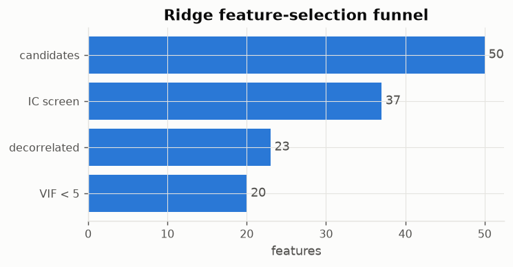
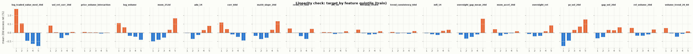
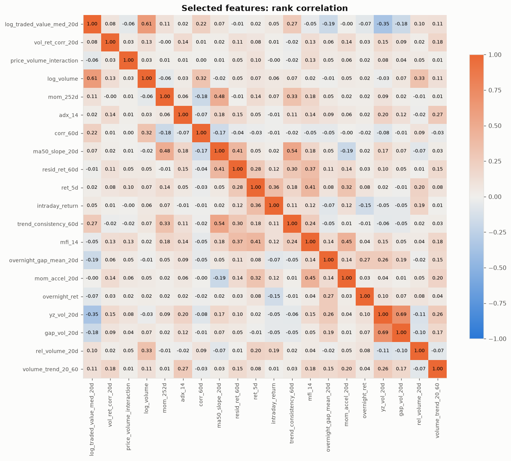
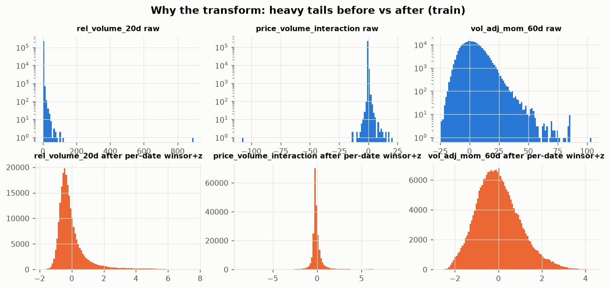
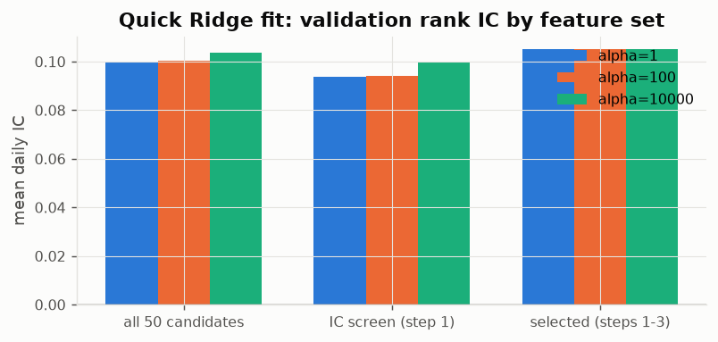

# 01 — Ridge Regression: EDA & feature selection

Prerequisite: `00_data_audit/REPORT.md` (shared audit, splits, IC table).

## Why Ridge needs this preparation
- Linear in the inputs → heavy-tailed features (kurtosis > 10 for most) dominate the fit unless winsorized.
- Features must be on one scale for the L2 penalty to be fair → per-date z-score.
- Market (`bench_*`) columns are constant on a date, so in a linear cross-sectional model they only move the intercept of every stock equally — they cannot change a ranking → excluded.
- Correlated inputs make coefficients unstable and sign-flipping → strict redundancy pruning + VIF.
- Per-date transforms use only same-day data, so they are leakage-free and need no refitting in walk-forward.

## Selection funnel (all statistics on TRAIN 2019–2022 only)

1. **IC screen**: |Newey–West t| ≥ 0.5 and same IC sign in ≥ 50% of train years → 37 of 50: `log_traded_value_med_20d`, `ma50_ma200_ratio`, `vol_ret_corr_20d`, `amihud_log_20d`, `price_volume_interaction`, `log_volume`, `mom_252d`, `adx_14`, `dist_ma200`, `mom_120d`, `rel_mom_120d`, `corr_60d`, `ma50_slope_20d`, `resid_ret_60d`, `beta_60d`, `ret_5d`, `intraday_return`, `ret_1d`, `vol_adj_mom_60d`, `trend_consistency_60d`, `mfi_14`, `rel_mom_60d`, `mom_60d`, `rel_mom_20d`, `mom_20d`, `overnight_gap_mean_20d`, `dist_ma20`, `mom_accel_20d`, `dist_ma50`, `beta_120d`, `overnight_ret`, `yz_vol_20d`, `rsi_14`, `gap_vol_20d`, `rel_volume_20d`, `vol_20d`, `volume_trend_20_60`
2. **Redundancy**: one feature per cluster of |cross-sectional rank corr| ≥ 0.8 (keep highest |t|) → 23
3. **VIF < 5.0**: removed [('rel_mom_20d', 6.86), ('ma50_ma200_ratio', 5.87), ('beta_60d', 5.68)] → **20 features**

## Selected features

| feature                  |   ic_mean |   ic_tstat_nw |   year_sign_stability |   pdf_tier |    VIF |   monotonicity |   ridge coef (a=100) | coef sign = IC sign   |
|:-------------------------|----------:|--------------:|----------------------:|-----------:|-------:|---------------:|---------------------:|:----------------------|
| log_traded_value_med_20d |   -0.0416 |       -2.6842 |                1.0000 |          4 | 2.5651 |        -1.0000 |              -0.0114 | True                  |
| vol_ret_corr_20d         |   -0.0217 |       -2.4867 |                0.7500 |          3 | 1.0985 |        -0.3000 |              -0.0013 | True                  |
| price_volume_interaction |   -0.0077 |       -2.2827 |                1.0000 |          3 | 1.4202 |        -0.9000 |              -0.0007 | True                  |
| log_volume               |   -0.0383 |       -2.2072 |                0.7500 |          4 | 2.2288 |        -1.0000 |               0.0050 | False                 |
| mom_252d                 |    0.0503 |        2.1826 |                1.0000 |          3 | 1.6572 |         1.0000 |               0.0059 | True                  |
| adx_14                   |    0.0232 |        1.9724 |                0.7500 |          3 | 1.1878 |         0.7000 |               0.0022 | True                  |
| corr_60d                 |   -0.0317 |       -1.5390 |                1.0000 |          2 | 1.1691 |        -1.0000 |              -0.0017 | True                  |
| ma50_slope_20d           |    0.0235 |        1.4140 |                0.7500 |          4 | 2.6179 |         0.7000 |              -0.0009 | False                 |
| resid_ret_60d            |   -0.0167 |       -1.3283 |                0.5000 |          1 | 1.7302 |        -0.4000 |              -0.0006 | True                  |
| ret_5d                   |   -0.0110 |       -1.1767 |                0.7500 |          3 | 1.6130 |         0.1000 |              -0.0010 | True                  |
| intraday_return          |   -0.0057 |       -1.1302 |                1.0000 |          3 | 1.4699 |        -0.3000 |               0.0003 | False                 |
| trend_consistency_60d    |    0.0134 |        1.0028 |                1.0000 |          4 | 1.7154 |         0.1000 |               0.0023 | True                  |
| mfi_14                   |   -0.0093 |       -0.9479 |                0.5000 |          3 | 1.6044 |         0.6000 |              -0.0011 | True                  |
| overnight_gap_mean_20d   |   -0.0089 |       -0.8272 |                0.7500 |          3 | 1.2823 |         0.7000 |              -0.0002 | True                  |
| mom_accel_20d            |   -0.0091 |       -0.7930 |                0.5000 |          2 | 1.5432 |         0.0000 |              -0.0001 | True                  |
| overnight_ret            |    0.0027 |        0.6743 |                0.5000 |          3 | 1.1940 |         0.7000 |               0.0009 | True                  |
| yz_vol_20d               |    0.0102 |        0.5850 |                0.5000 |          2 | 2.7379 |         1.0000 |               0.0021 | True                  |
| gap_vol_20d              |   -0.0088 |       -0.5354 |                0.5000 |          3 | 2.0575 |         0.9000 |              -0.0035 | True                  |
| rel_volume_20d           |   -0.0028 |       -0.5268 |                1.0000 |          2 | 1.3896 |        -0.1000 |              -0.0008 | True                  |
| volume_trend_20_60       |   -0.0054 |       -0.5012 |                0.5000 |          4 | 1.3411 |        -0.3000 |              -0.0003 | True                  |

Monotonicity = Spearman correlation between quintile number and mean target (±1 = perfectly linear-friendly).

Redundancy clusters among the IC-screened features:

|                          |   cluster |   score | kept   |
|:-------------------------|----------:|--------:|:-------|
| ma50_slope_20d           |         1 |   1.414 | True   |
| vol_adj_mom_60d          |         1 |   1.048 | False  |
| rel_mom_60d              |         1 |   0.933 | False  |
| mom_60d                  |         1 |   0.933 | False  |
| ma50_ma200_ratio         |         2 |   2.563 | True   |
| dist_ma200               |         2 |   1.904 | False  |
| mom_120d                 |         2 |   1.876 | False  |
| rel_mom_120d             |         2 |   1.876 | False  |
| mom_252d                 |         3 |   2.183 | True   |
| trend_consistency_60d    |         4 |   1.003 | True   |
| rel_mom_20d              |         5 |   0.883 | True   |
| mom_20d                  |         5 |   0.883 | False  |
| dist_ma20                |         5 |   0.798 | False  |
| dist_ma50                |         5 |   0.729 | False  |
| rsi_14                   |         5 |   0.545 | False  |
| mfi_14                   |         6 |   0.948 | True   |
| ret_5d                   |         7 |   1.177 | True   |
| mom_accel_20d            |         8 |   0.793 | True   |
| resid_ret_60d            |         9 |   1.328 | True   |
| intraday_return          |        10 |   1.130 | True   |
| ret_1d                   |        10 |   1.052 | False  |
| rel_volume_20d           |        11 |   0.527 | True   |
| overnight_gap_mean_20d   |        12 |   0.827 | True   |
| overnight_ret            |        13 |   0.674 | True   |
| log_traded_value_med_20d |        14 |   2.684 | True   |
| amihud_log_20d           |        14 |   2.355 | False  |
| log_volume               |        15 |   2.207 | True   |
| beta_60d                 |        16 |   1.241 | True   |
| beta_120d                |        16 |   0.692 | False  |
| corr_60d                 |        17 |   1.539 | True   |
| yz_vol_20d               |        18 |   0.585 | True   |
| vol_20d                  |        18 |   0.525 | False  |
| gap_vol_20d              |        19 |   0.535 | True   |
| adx_14                   |        20 |   1.972 | True   |
| volume_trend_20_60       |        21 |   0.501 | True   |
| vol_ret_corr_20d         |        22 |   2.487 | True   |
| price_volume_interaction |        23 |   2.283 | True   |

## Sanity check: does the selection help out of sample?

Plain Ridge on `y_win`, fit on train, scored by mean daily rank IC on validation (2023–mid 2024). This is a check on the feature set, not model tuning (that comes next).

**Read with care:** the validation window holds only ~17 non-overlapping 20-day periods, so the standard error of a mean IC is roughly IC / t ≈ 0.03. Differences of ±0.01 between feature sets are noise. Variants tried during design (no IC screen; |t| ≥ 1; corr cut 0.7/0.8/0.9; VIF 5/10) all landed between 0.089 and 0.105. The loose screen + decorrelation + VIF set was chosen on principle (interpretable, stable coefficients), not because it had the best validation number.

| feature set          |   n |   alpha |   train IC |   val IC |   val IC NW t |
|:---------------------|----:|--------:|-----------:|---------:|--------------:|
| all 50 candidates    |  50 |       1 |     0.0986 |   0.1001 |        3.8361 |
| all 50 candidates    |  50 |     100 |     0.0986 |   0.1002 |        3.8324 |
| all 50 candidates    |  50 |   10000 |     0.0961 |   0.1038 |        3.7598 |
| IC screen (step 1)   |  37 |       1 |     0.0872 |   0.0938 |        3.4050 |
| IC screen (step 1)   |  37 |     100 |     0.0872 |   0.0940 |        3.4027 |
| IC screen (step 1)   |  37 |   10000 |     0.0853 |   0.1001 |        3.4923 |
| selected (steps 1-3) |  20 |       1 |     0.0719 |   0.1050 |        3.9687 |
| selected (steps 1-3) |  20 |     100 |     0.0719 |   0.1050 |        3.9698 |
| selected (steps 1-3) |  20 |   10000 |     0.0720 |   0.1051 |        4.0066 |

## Model-ready dataset

`data/ridge_dataset.parquet` — 505,146 rows. Columns: `Date, Symbol, split, has_target, tradable`, 20 features (float32, per-date winsorized z-scores, no NaN), targets `y_raw, y_win, y_rank, y_class`.

| split   |   rows |   with_target | first               | last                |
|:--------|-------:|--------------:|:--------------------|:--------------------|
| burn_in |  55579 |         55579 | 2018-01-01 00:00:00 | 2018-12-31 00:00:00 |
| purge   |   9520 |          9520 | 2022-12-05 00:00:00 | 2024-06-28 00:00:00 |
| test    | 126854 |        122094 | 2024-07-01 00:00:00 | 2026-08-21 00:00:00 |
| train   | 230131 |        230131 | 2019-01-01 00:00:00 | 2022-12-02 00:00:00 |
| val     |  83062 |         83062 | 2023-01-02 00:00:00 | 2024-05-30 00:00:00 |

Use: `X = df[features]`, `y = df.y_win` for rows with `split == 'train'` and `has_target`; tune on `val`; never touch `test` until the final run. Drop `purge` and `burn_in` rows. Evaluate with `y_raw`. Feature list: `selected_features.json`.