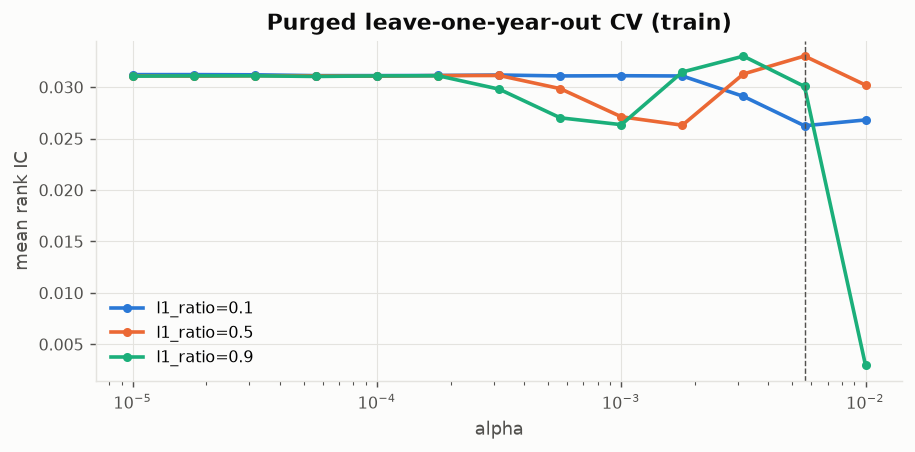
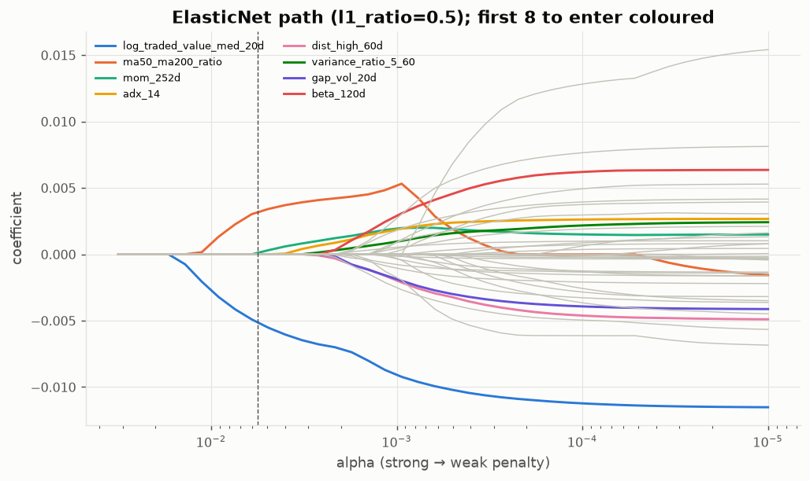
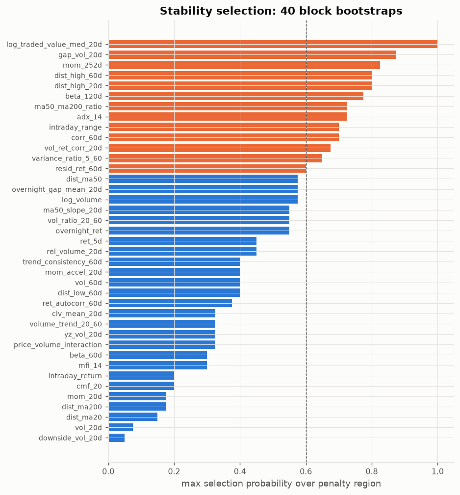

# 02 — ElasticNet: EDA & feature selection

Prerequisite: `00_data_audit/REPORT.md`. Same transform as Ridge (per-date winsorize + z-score, market columns excluded).

## Why ElasticNet is prepared differently from Ridge
- The L1 term selects features itself, so a hard filter would pre-empt what the model is for. We remove only near-duplicates (|rank corr| ≥ 0.9) — e.g. `mom_k` vs `rel_mom_k` are the same feature within a date.
- Lasso picks one member of a correlated group arbitrarily; ElasticNet's L2 part spreads weight across the group. The stability analysis shows which picks are reliable.

## Step 1 — near-duplicates removed (11): `ret_1d`, `mom_60d`, `mom_120d`, `rel_mom_20d`, `rel_mom_60d`, `rel_mom_120d`, `parkinson_vol_20d`, `vol_adj_mom_60d`, `rel_vol_60d`, `amihud_log_20d`, `rsi_14`

→ **39 pre-screened features** go into the dataset.

## Step 2 — penalty strength (purged leave-one-year-out CV on train, every 5th date)

Best CV IC 0.0330 at **alpha=0.0056, l1_ratio=0.5** (5 non-zero on average). The curve is flat: models with 5 and with 39 active features score within ~0.002 IC of each other, i.e. the data cannot distinguish them. The suggested alpha is a starting point for the modelling step, not a final tuning.

## Step 3 — stability selection (40 bootstraps of half the 60-day blocks)

Meinshausen–Bühlmann: selection probability = max over the penalty region alpha ∈ [0.0014, 0.0049] (best-CV alpha down to ≤ 15 active features). Average union size q = 19.5, so the expected number of falsely selected features at threshold 0.6 is ≤ q²/((2π−1)p) = **48.63**.

**13 features selected in ≥ 60% of resamples**: `log_traded_value_med_20d`, `gap_vol_20d`, `mom_252d`, `dist_high_20d`, `dist_high_60d`, `beta_120d`, `adx_14`, `ma50_ma200_ratio`, `corr_60d`, `intraday_range`, `vol_ret_corr_20d`, `variance_ratio_5_60`, `resid_ret_60d`

|                          |   selection_freq |   entry_alpha |   coef (train fit) |    ic_mean |   ic_tstat_nw |   pdf_tier |
|:-------------------------|-----------------:|--------------:|-------------------:|-----------:|--------------:|-----------:|
| log_traded_value_med_20d |            1     |     0.01384   |          -0.005163 | -0.04159   |     -2.684    |          4 |
| gap_vol_20d              |            0.875 |     0.002154  |          -0        | -0.008822  |     -0.5354   |          3 |
| mom_252d                 |            0.825 |     0.004924  |           0.000123 |  0.05029   |      2.183    |          3 |
| dist_high_60d            |            0.8   |     0.002649  |          -0        | -0.007791  |     -0.384    |          4 |
| dist_high_20d            |            0.8   |     0.001752  |           0        | -0.002544  |     -0.1566   |          4 |
| beta_120d                |            0.775 |     0.002154  |           0        | -0.01931   |     -0.6923   |          2 |
| adx_14                   |            0.725 |     0.004005  |           0        |  0.02315   |      1.972    |          3 |
| ma50_ma200_ratio         |            0.725 |     0.01125   |           0.003322 |  0.05204   |      2.563    |          4 |
| intraday_range           |            0.7   |     0.001752  |           0        |  0.0002964 |      0.02735  |          4 |
| corr_60d                 |            0.7   |     0.002154  |          -0        | -0.0317    |     -1.539    |          2 |
| vol_ret_corr_20d         |            0.675 |     0.002154  |          -0        | -0.02166   |     -2.487    |          3 |
| variance_ratio_5_60      |            0.65  |     0.002649  |           0        |  0.00363   |      0.4004   |          2 |
| resid_ret_60d            |            0.6   |     0.001159  |           0        | -0.01669   |     -1.328    |          1 |
| log_volume               |            0.575 |     0.001752  |           0        | -0.03832   |     -2.207    |          4 |
| overnight_gap_mean_20d   |            0.575 |     0.0004125 |           0        | -0.008877  |     -0.8272   |          3 |
| dist_ma50                |            0.575 |     0.001425  |          -0        | -0.01153   |     -0.7291   |          2 |
| ma50_slope_20d           |            0.55  |     0.0006236 |           0        |  0.02349   |      1.414    |          4 |
| vol_ratio_20_60          |            0.55  |     0.001159  |          -0        | -0.002301  |     -0.2331   |          2 |
| overnight_ret            |            0.55  |     0.002154  |           0        |  0.002689  |      0.6743   |          3 |
| rel_volume_20d           |            0.45  |     0.0007667 |           0        | -0.002813  |     -0.5268   |          2 |
| ret_5d                   |            0.45  |     0.001159  |          -0        | -0.01104   |     -1.177    |          3 |
| mom_accel_20d            |            0.4   |     1.859e-05 |          -0        | -0.009146  |     -0.793    |          2 |
| vol_60d                  |            0.4   |     3.455e-05 |           0        | -0.006366  |     -0.3158   |          2 |
| dist_low_60d             |            0.4   |     0.0009427 |           0        | -0.002023  |     -0.1802   |          4 |
| trend_consistency_60d    |            0.4   |     0.001159  |           0        |  0.01343   |      1.003    |          4 |
| ret_autocorr_60d         |            0.375 |     0.0002219 |           0        | -0.004788  |     -0.4734   |          3 |
| clv_mean_20d             |            0.325 |     0.0005071 |          -0        | -7.166e-05 |     -0.004891 |          3 |
| yz_vol_20d               |            0.325 |     0.0009427 |           0        |  0.01018   |      0.585    |          2 |
| volume_trend_20_60       |            0.325 |     0.0007667 |           0        | -0.005445  |     -0.5012   |          4 |
| price_volume_interaction |            0.325 |     0.001159  |          -0        | -0.007679  |     -2.283    |          3 |
| beta_60d                 |            0.3   |     6.422e-05 |          -0        | -0.0317    |     -1.241    |          2 |
| mfi_14                   |            0.3   |     0.0009427 |          -0        | -0.009325  |     -0.9479   |          3 |
| cmf_20                   |            0.2   |     7.897e-05 |          -0        | -0.005856  |     -0.4727   |          3 |
| intraday_return          |            0.2   |     0.0004125 |          -0        | -0.005726  |     -1.13     |          3 |
| dist_ma200               |            0.175 |     0.0007667 |           0        |  0.03801   |      1.904    |          2 |
| mom_20d                  |            0.175 |     0.0007667 |          -0        | -0.0123    |     -0.8832   |          3 |
| dist_ma20                |            0.15  |     0.0004125 |           0        | -0.0104    |     -0.7984   |          2 |
| vol_20d                  |            0.075 |     0.0001468 |           0        | -0.007966  |     -0.5255   |          2 |
| downside_vol_20d         |            0.05  |     0.0005071 |           0        | -0.006286  |     -0.334    |          2 |

## Sanity check on validation (fit on train at the suggested alpha / l1_ratio)

| feature set             |   n in |   n nonzero |   val IC |   val IC NW t |
|:------------------------|-------:|------------:|---------:|--------------:|
| all 50 candidates       |     50 |           4 |   0.0962 |        3.4519 |
| pre-screened (corr<0.9) |     39 |           3 |   0.0892 |        3.6174 |
| stable (freq>=0.6)      |     13 |           3 |   0.0892 |        3.6176 |

Validation holds ~17 independent 20-day periods: an IC standard error of ~0.03 means small differences are noise.

## Model-ready dataset

`data/elasticnet_dataset.parquet` — 505,146 rows, 39 pre-screened features (float32, no NaN), targets `y_raw, y_win, y_rank, y_class`.

| split   |   rows |   with_target | first               | last                |
|:--------|-------:|--------------:|:--------------------|:--------------------|
| burn_in |  55579 |         55579 | 2018-01-01 00:00:00 | 2018-12-31 00:00:00 |
| purge   |   9520 |          9520 | 2022-12-05 00:00:00 | 2024-06-28 00:00:00 |
| test    | 126854 |        122094 | 2024-07-01 00:00:00 | 2026-08-21 00:00:00 |
| train   | 230131 |        230131 | 2019-01-01 00:00:00 | 2022-12-02 00:00:00 |
| val     |  83062 |         83062 | 2023-01-02 00:00:00 | 2024-05-30 00:00:00 |

Recommended use: feed all `features` from `selected_features.json` and let the penalty select; `stable_features` is the conservative alternative for an ablation. Train on `split == 'train'`, tune on `val`, evaluate on `y_raw`.