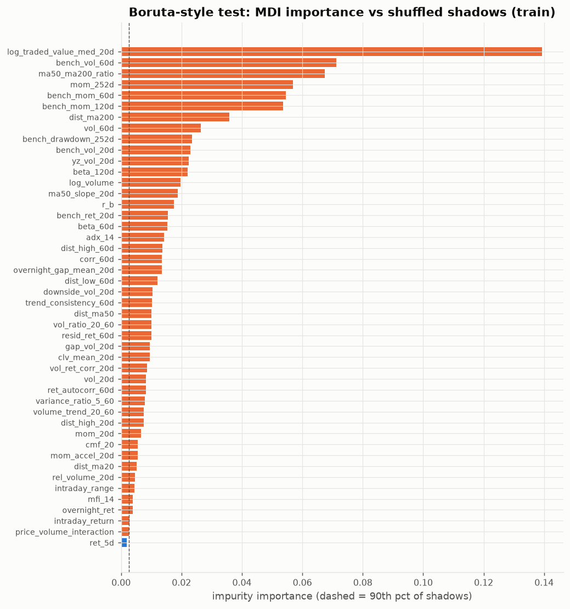
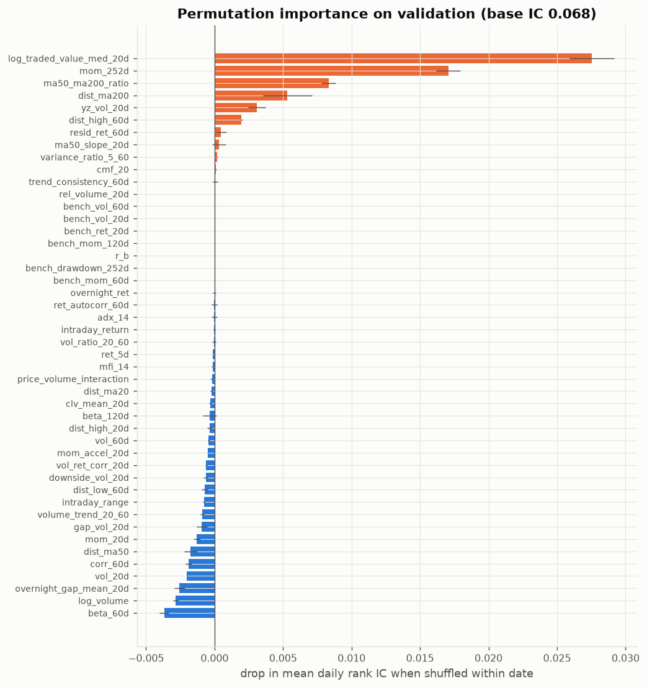
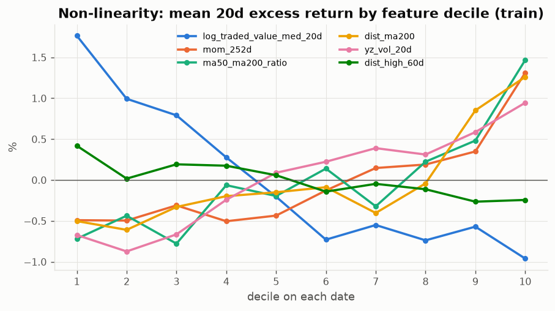
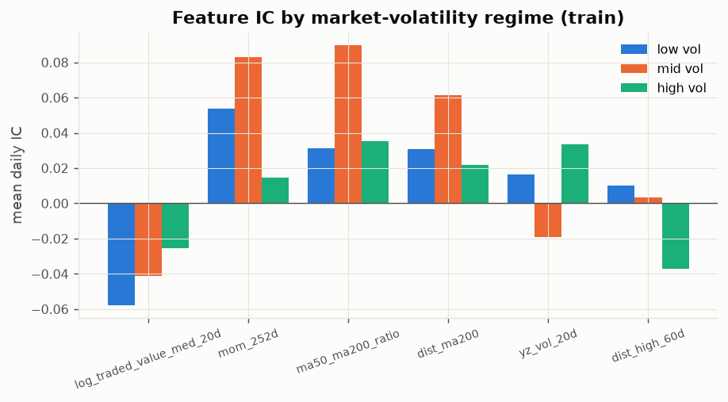

# 03 — Random Forest: EDA & feature selection

Prerequisite: `00_data_audit/REPORT.md`.

## Why RF is prepared differently
- Trees split on order, not scale, so no winsorizing/z-scoring is needed. Stock features are still converted to **per-date percentile ranks**, so a split threshold means the same thing in every year (raw volatility or volume levels drift).
- **Market-regime columns are kept** (raw): trees can interact them with stock features. The regime chart below shows several features whose IC changes size or sign with market volatility.
- Correlated features split importance between them and make importances unreadable → near-duplicates removed (|corr| ≥ 0.9).
- Fitting uses every 5th train date: consecutive 20-day targets overlap 95%, so the extra rows add almost no information but inflate leaf purity (overfitting).

## Selection

1. Redundancy: stock 50 → 39, market 8 → 7 (dropped market: `bench_dist_ma200`).
2. Boruta-style shadow test: 45 of 46 beat the 90th percentile of shuffled copies.
3. Permutation importance on validation (shuffle within date, 3 repeats): 12 have a positive IC drop.
4. **Selected = passes 2 and 3** (market columns need only pass 2, since within-date shuffling cannot measure a date-constant feature) → **19 features**: `mom_252d`, `dist_high_60d`, `dist_ma200`, `ma50_ma200_ratio`, `ma50_slope_20d`, `trend_consistency_60d`, `log_traded_value_med_20d`, `rel_volume_20d`, `resid_ret_60d`, `yz_vol_20d`, `variance_ratio_5_60`, `cmf_20`, `r_b`, `bench_ret_20d`, `bench_mom_60d`, `bench_mom_120d`, `bench_vol_20d`, `bench_vol_60d`, `bench_drawdown_252d`

|                          |      MDI | beats_shadow   |    ic_drop |   ic_drop_sd |     ic_mean |   pdf_tier | selected   |
|:-------------------------|---------:|:---------------|-----------:|-------------:|------------:|-----------:|:-----------|
| log_traded_value_med_20d | 0.1394   | True           |  0.02754   |    0.001626  |  -0.04159   |          4 | True       |
| mom_252d                 | 0.05687  | True           |  0.01705   |    0.0008751 |   0.05029   |          3 | True       |
| ma50_ma200_ratio         | 0.06745  | True           |  0.008321  |    0.0005052 |   0.05204   |          4 | True       |
| dist_ma200               | 0.03577  | True           |  0.005323  |    0.001805  |   0.03801   |          2 | True       |
| yz_vol_20d               | 0.02237  | True           |  0.003082  |    0.0006457 |   0.01018   |          2 | True       |
| dist_high_60d            | 0.01374  | True           |  0.001974  |    7.861e-05 |  -0.007791  |          4 | True       |
| resid_ret_60d            | 0.01009  | True           |  0.000475  |    0.0003838 |  -0.01669   |          1 | True       |
| ma50_slope_20d           | 0.01874  | True           |  0.0003368 |    0.0005073 |   0.02349   |          4 | True       |
| variance_ratio_5_60      | 0.007804 | True           |  0.0001781 |    4.187e-05 |   0.00363   |          2 | True       |
| cmf_20                   | 0.005486 | True           |  8.49e-05  |    4.64e-05  |  -0.005856  |          3 | True       |
| trend_consistency_60d    | 0.01022  | True           |  4.82e-05  |    0.0001863 |   0.01343   |          4 | True       |
| rel_volume_20d           | 0.004651 | True           |  1.925e-05 |    2.26e-05  |  -0.002813  |          2 | True       |
| bench_mom_120d           | 0.05372  | True           |  0         |    0         | nan         |        nan | True       |
| bench_mom_60d            | 0.05454  | True           |  0         |    0         | nan         |        nan | True       |
| bench_drawdown_252d      | 0.02347  | True           |  0         |    0         | nan         |        nan | True       |
| bench_vol_60d            | 0.07125  | True           |  0         |    0         | nan         |        nan | True       |
| bench_ret_20d            | 0.01544  | True           |  0         |    0         | nan         |        nan | True       |
| bench_vol_20d            | 0.02291  | True           |  0         |    0         | nan         |        nan | True       |
| r_b                      | 0.01741  | True           |  0         |    0         | nan         |        nan | True       |
| overnight_ret            | 0.003792 | True           | -6.527e-06 |    0.0001048 |   0.002689  |          3 | False      |
| ret_autocorr_60d         | 0.008236 | True           | -1.695e-05 |    0.0001998 |  -0.004788  |          3 | False      |
| adx_14                   | 0.01421  | True           | -2.171e-05 |    0.0001901 |   0.02315   |          3 | False      |
| intraday_return          | 0.002843 | True           | -2.342e-05 |    7.155e-05 |  -0.005726  |          3 | False      |
| vol_ratio_20_60          | 0.01009  | True           | -5.606e-05 |    0.0001351 |  -0.002301  |          2 | False      |
| ret_5d                   | 0.001901 | False          | -0.0001167 |    2.33e-05  |  -0.01104   |          3 | False      |
| mfi_14                   | 0.003905 | True           | -0.0001433 |    7.061e-05 |  -0.009325  |          3 | False      |
| price_volume_interaction | 0.00269  | True           | -0.000184  |    0.0001154 |  -0.007679  |          3 | False      |
| dist_ma20                | 0.005204 | True           | -0.0002026 |    8.891e-05 |  -0.0104    |          2 | False      |
| clv_mean_20d             | 0.009418 | True           | -0.0003115 |    9.501e-05 |  -7.166e-05 |          3 | False      |
| beta_120d                | 0.02198  | True           | -0.0003438 |    0.0004996 |  -0.01931   |          2 | False      |
| dist_high_20d            | 0.007428 | True           | -0.0003532 |    0.000182  |  -0.002544  |          4 | False      |
| vol_60d                  | 0.02639  | True           | -0.0004231 |    8.605e-05 |  -0.006366  |          2 | False      |
| mom_accel_20d            | 0.005477 | True           | -0.0005086 |    1.153e-05 |  -0.009146  |          2 | False      |
| vol_ret_corr_20d         | 0.008606 | True           | -0.0006054 |    6.342e-05 |  -0.02166   |          3 | False      |
| downside_vol_20d         | 0.01041  | True           | -0.0006474 |    0.0001783 |  -0.006286  |          2 | False      |
| dist_low_60d             | 0.0121   | True           | -0.0006995 |    0.0002247 |  -0.002023  |          4 | False      |
| intraday_range           | 0.004425 | True           | -0.000773  |    6.113e-05 |   0.0002964 |          4 | False      |
| volume_trend_20_60       | 0.007505 | True           | -0.0009031 |    0.0001414 |  -0.005445  |          4 | False      |
| gap_vol_20d              | 0.009481 | True           | -0.0009215 |    0.0004037 |  -0.008822  |          3 | False      |
| mom_20d                  | 0.006566 | True           | -0.001304  |    0.0002489 |  -0.0123    |          3 | False      |
| dist_ma50                | 0.01011  | True           | -0.00174   |    0.0004641 |  -0.01153   |          2 | False      |
| corr_60d                 | 0.01356  | True           | -0.001898  |    0.0002144 |  -0.0317    |          2 | False      |
| vol_20d                  | 0.008271 | True           | -0.002008  |    3.727e-05 |  -0.007966  |          2 | False      |
| overnight_gap_mean_20d   | 0.01355  | True           | -0.002558  |    0.0003794 |  -0.008877  |          3 | False      |
| log_volume               | 0.01969  | True           | -0.002823  |    0.0001826 |  -0.03832   |          4 | False      |
| beta_60d                 | 0.01537  | True           | -0.003677  |    0.0003327 |  -0.0317    |          2 | False      |

## Non-linearity and regimes (why a tree model is worth trying)

|                          |   low vol |   mid vol |   high vol |
|:-------------------------|----------:|----------:|-----------:|
| log_traded_value_med_20d |   -0.0577 |   -0.0414 |    -0.0255 |
| mom_252d                 |    0.0537 |    0.0828 |     0.0147 |
| ma50_ma200_ratio         |    0.0313 |    0.0897 |     0.0351 |
| dist_ma200               |    0.0308 |    0.0612 |     0.0219 |
| yz_vol_20d               |    0.0162 |   -0.0190 |     0.0334 |
| dist_high_60d            |    0.0100 |    0.0033 |    -0.0370 |

## Sanity check on validation

| feature set      |   n |   val IC |   val IC NW t |
|:-----------------|----:|---------:|--------------:|
| after redundancy |  46 |   0.0678 |        3.1084 |
| selected         |  19 |   0.0834 |        3.4435 |

Caveat: validation was also used for the permutation step, so the `selected` row is mildly optimistic. The test period stays untouched.

## Model-ready dataset

`data/rf_dataset.parquet` — 505,146 rows, 19 features (float32, no NaN), targets `y_raw, y_win, y_rank, y_class`.

| split   |   rows |   with_target | first               | last                |
|:--------|-------:|--------------:|:--------------------|:--------------------|
| burn_in |  55579 |         55579 | 2018-01-01 00:00:00 | 2018-12-31 00:00:00 |
| purge   |   9520 |          9520 | 2022-12-05 00:00:00 | 2024-06-28 00:00:00 |
| test    | 126854 |        122094 | 2024-07-01 00:00:00 | 2026-08-21 00:00:00 |
| train   | 230131 |        230131 | 2019-01-01 00:00:00 | 2022-12-02 00:00:00 |
| val     |  83062 |         83062 | 2023-01-02 00:00:00 | 2024-05-30 00:00:00 |

Use rows with `split == 'train'` and `has_target` (thin to every 5th date, or use `max_samples`), tune `max_depth`, `min_samples_leaf`, `max_features` on `val`, evaluate with `y_raw`.