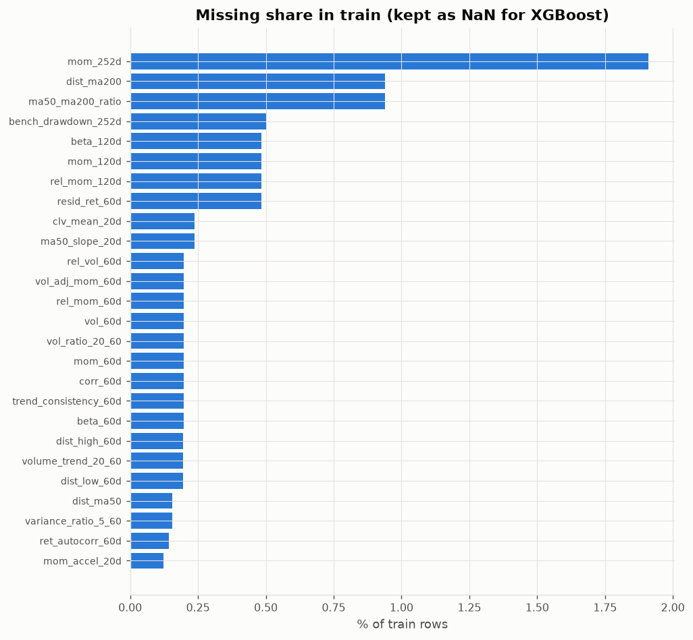
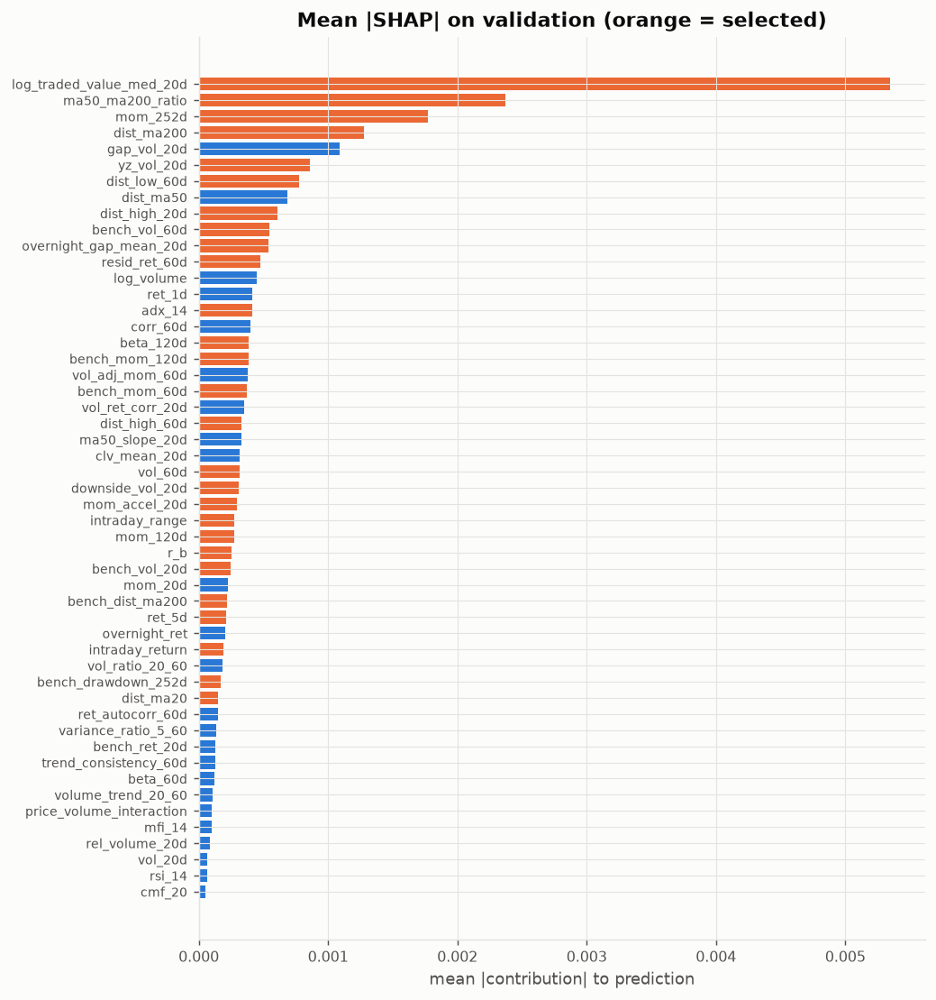
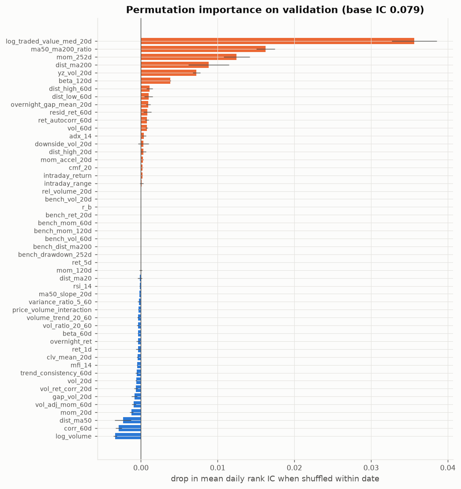
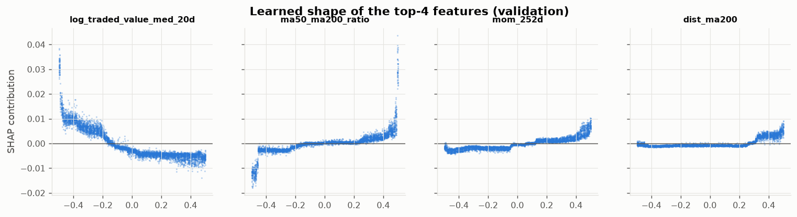

# 04 — XGBoost: EDA & feature selection

Prerequisite: `00_data_audit/REPORT.md`.

## Why XGBoost is prepared differently
- **Missing values are kept.** XGBoost learns a default direction for NaN at every split, so imputing would throw away the information that a stock is newly listed / has short history. The table below checks whether missingness relates to the target.
- Stock features are per-date ranks (stable split thresholds across years); market-regime columns are kept raw.
- Only near-exact duplicates are removed first (|corr| ≥ 0.95); boosting then reveals usefulness through SHAP and validation permutation importance. Early stopping on validation guards the selection fit.

## Missingness

| feature               |   na_share_train |   na_share_val |   mean_y_when_na |   mean_y_when_present |
|:----------------------|-----------------:|---------------:|-----------------:|----------------------:|
| mom_60d               |           0.0020 |         0.0000 |           0.0280 |                0.0000 |
| mom_120d              |           0.0048 |         0.0000 |           0.0527 |               -0.0002 |
| mom_252d              |           0.0191 |         0.0000 |           0.0229 |               -0.0003 |
| rel_mom_60d           |           0.0020 |         0.0000 |           0.0280 |                0.0000 |
| rel_mom_120d          |           0.0048 |         0.0000 |           0.0527 |               -0.0002 |
| vol_60d               |           0.0020 |         0.0000 |           0.0280 |                0.0000 |
| vol_ratio_20_60       |           0.0020 |         0.0000 |           0.0280 |                0.0000 |
| vol_adj_mom_60d       |           0.0020 |         0.0000 |           0.0280 |                0.0000 |
| mom_accel_20d         |           0.0012 |         0.0000 |           0.0409 |                0.0001 |
| dist_high_60d         |           0.0019 |         0.0000 |           0.0275 |                0.0000 |
| dist_low_60d          |           0.0019 |         0.0000 |           0.0275 |                0.0000 |
| dist_ma50             |           0.0016 |         0.0000 |           0.0348 |                0.0000 |
| dist_ma200            |           0.0094 |         0.0000 |           0.0310 |               -0.0002 |
| ma50_ma200_ratio      |           0.0094 |         0.0000 |           0.0310 |               -0.0002 |
| ma50_slope_20d        |           0.0024 |         0.0000 |           0.0378 |                0.0000 |
| trend_consistency_60d |           0.0020 |         0.0000 |           0.0280 |                0.0000 |
| volume_trend_20_60    |           0.0019 |         0.0000 |           0.0275 |                0.0000 |
| clv_mean_20d          |           0.0024 |         0.0015 |           0.0541 |               -0.0000 |
| beta_60d              |           0.0020 |         0.0000 |           0.0280 |                0.0000 |
| beta_120d             |           0.0048 |         0.0000 |           0.0527 |               -0.0002 |
| corr_60d              |           0.0020 |         0.0000 |           0.0280 |                0.0000 |
| rel_vol_60d           |           0.0020 |         0.0000 |           0.0280 |                0.0000 |
| resid_ret_60d         |           0.0048 |         0.0000 |           0.0527 |               -0.0002 |
| variance_ratio_5_60   |           0.0016 |         0.0000 |           0.0348 |                0.0000 |
| ret_autocorr_60d      |           0.0014 |         0.0000 |           0.0377 |                0.0000 |
| bench_drawdown_252d   |           0.0050 |         0.0000 |           0.0001 |                0.0001 |

## Selection

1. Duplicates removed → 51 (43 stock + 8 market).
2. XGBoost (depth 4, lr 0.03, early-stopped at 87 trees) on every 5th train date. Features that make up 95% of total mean |SHAP| on validation: 39.
3. Removed features whose within-date shuffle *raises* validation IC by more than one s.d.: `rsi_14`, `ma50_slope_20d`, `variance_ratio_5_60`, `price_volume_interaction`, `volume_trend_20_60`, `vol_ratio_20_60`, `beta_60d`, `overnight_ret`, `ret_1d`, `clv_mean_20d`, `mfi_14`, `trend_consistency_60d`, `vol_20d`, `vol_ret_corr_20d`, `gap_vol_20d`, `vol_adj_mom_60d`, `mom_20d`, `dist_ma50`, `corr_60d`, `log_volume`.
→ **27 features**: `ret_5d`, `mom_120d`, `mom_252d`, `vol_60d`, `downside_vol_20d`, `mom_accel_20d`, `dist_high_20d`, `dist_high_60d`, `dist_low_60d`, `dist_ma20`, `dist_ma200`, `ma50_ma200_ratio`, `log_traded_value_med_20d`, `intraday_return`, `intraday_range`, `overnight_gap_mean_20d`, `beta_120d`, `resid_ret_60d`, `yz_vol_20d`, `adx_14`, `r_b`, `bench_mom_60d`, `bench_mom_120d`, `bench_vol_20d`, `bench_vol_60d`, `bench_dist_ma200`, `bench_drawdown_252d`

|                          |   mean_abs_shap |   cum_share |   total_gain |    ic_drop |   ic_drop_sd |     ic_mean |   pdf_tier | selected   |
|:-------------------------|----------------:|------------:|-------------:|-----------:|-------------:|------------:|-----------:|:-----------|
| adx_14                   |       0.0004101 |      0.6871 |        7.948 |  0.0003906 |    0.000287  |   0.02315   |          3 | True       |
| bench_dist_ma200         |       0.0002175 |      0.9086 |       10.68  |  0         |    0         | nan         |        nan | True       |
| bench_drawdown_252d      |       0.000172  |      0.946  |        7.859 |  0         |    0         | nan         |        nan | True       |
| bench_mom_120d           |       0.0003856 |      0.733  |       27.08  |  0         |    0         | nan         |        nan | True       |
| bench_mom_60d            |       0.0003734 |      0.7624 |       19.51  |  0         |    0         | nan         |        nan | True       |
| bench_ret_20d            |       0.0001271 |      0.9678 |        4.067 |  0         |    0         | nan         |        nan | False      |
| bench_vol_20d            |       0.0002434 |      0.8912 |        7.907 |  0         |    0         | nan         |        nan | True       |
| bench_vol_60d            |       0.0005465 |      0.5979 |       46.15  |  0         |    0         | nan         |        nan | True       |
| beta_120d                |       0.000388  |      0.7179 |        9.528 |  0.003843  |    5.321e-05 |  -0.01931   |          2 | True       |
| beta_60d                 |       0.0001228 |      0.9775 |        3.289 | -0.0003748 |    5.291e-05 |  -0.0317    |          2 | False      |
| clv_mean_20d             |       0.0003179 |      0.8145 |        7.638 | -0.0004369 |    0.0001126 |  -7.166e-05 |          3 | False      |
| cmf_20                   |       5.458e-05 |      1      |        2.045 |  0.0002168 |    3.947e-05 |  -0.005856  |          3 | False      |
| corr_60d                 |       0.0004019 |      0.7028 |        6.26  | -0.002889  |    0.000393  |  -0.0317    |          2 | False      |
| dist_high_20d            |       0.0006062 |      0.5766 |        5.467 |  0.0002971 |    0.0003357 |  -0.002544  |          4 | True       |
| dist_high_60d            |       0.0003329 |      0.7891 |        8.31  |  0.001123  |    0.0003864 |  -0.007791  |          4 | True       |
| dist_low_60d             |       0.0007791 |      0.5262 |       10.75  |  0.0009974 |    0.0005406 |  -0.002023  |          4 | True       |
| dist_ma20                |       0.0001509 |      0.9518 |        2.208 | -0.0001493 |    0.0002901 |  -0.0104    |          2 | True       |
| dist_ma200               |       0.001279  |      0.4199 |        9.973 |  0.008826  |    0.00267   |   0.03801   |          2 | True       |
| dist_ma50                |       0.0006864 |      0.5529 |        4.984 | -0.002355  |    0.001055  |  -0.01153   |          2 | False      |
| downside_vol_20d         |       0.0003125 |      0.8389 |        4.693 |  0.0003081 |    0.0006774 |  -0.006286  |          2 | True       |
| gap_vol_20d              |       0.001086  |      0.4623 |        8.582 | -0.0008499 |    0.0003856 |  -0.008822  |          3 | False      |
| intraday_range           |       0.0002752 |      0.861  |        3.083 |  8.238e-05 |    0.0002315 |   0.0002964 |          4 | True       |
| intraday_return          |       0.0001896 |      0.9321 |        2.191 |  0.0001789 |    2.371e-05 |  -0.005726  |          3 | True       |
| log_traded_value_med_20d |       0.005348  |      0.2085 |       47.11  |  0.03563   |    0.002928  |  -0.04159   |          4 | True       |
| log_volume               |       0.0004496 |      0.6551 |        8.613 | -0.003344  |    0.0002345 |  -0.03832   |          4 | False      |
| ma50_ma200_ratio         |       0.002372  |      0.301  |       38.06  |  0.01624   |    0.001202  |   0.05204   |          4 | True       |
| ma50_slope_20d           |       0.0003326 |      0.8021 |        8.963 | -0.0001944 |    2.654e-05 |   0.02349   |          4 | False      |
| mfi_14                   |       9.864e-05 |      0.9894 |        1.831 | -0.000502  |    5.081e-05 |  -0.009325  |          3 | False      |
| mom_120d                 |       0.0002731 |      0.8717 |        6.499 | -3.095e-05 |    0.0001897 |   0.03307   |          3 | True       |
| mom_20d                  |       0.0002281 |      0.9001 |        3.053 | -0.001237  |    0.0002556 |  -0.0123    |          3 | False      |
| mom_252d                 |       0.00177   |      0.3701 |       25.92  |  0.01247   |    0.001704  |   0.05029   |          3 | True       |
| mom_accel_20d            |       0.0002928 |      0.8503 |        4.043 |  0.0002858 |    5.879e-05 |  -0.009146  |          2 | True       |
| overnight_gap_mean_20d   |       0.0005401 |      0.6189 |        7.308 |  0.0009534 |    0.000286  |  -0.008877  |          3 | True       |
| overnight_ret            |       0.0002026 |      0.9247 |        2.006 | -0.0003826 |    0.0002199 |   0.002689  |          3 | False      |
| price_volume_interaction |       0.0001025 |      0.9855 |        1.28  | -0.0003105 |    4.587e-05 |  -0.007679  |          3 | False      |
| r_b                      |       0.0002562 |      0.8817 |        6.867 |  0         |    0         | nan         |        nan | True       |
| rel_volume_20d           |       8.629e-05 |      0.9927 |        1.619 |  4.229e-05 |    9.76e-06  |  -0.002813  |          2 | False      |
| resid_ret_60d            |       0.000478  |      0.6376 |        6.436 |  0.0008344 |    0.0005121 |  -0.01669   |          1 | True       |
| ret_1d                   |       0.0004114 |      0.6711 |        3.264 | -0.0003829 |    0.0002699 |  -0.004967  |          2 | False      |
| ret_5d                   |       0.0002108 |      0.9168 |        2.056 |  0         |    0         |  -0.01104   |          3 | True       |
| ret_autocorr_60d         |       0.0001463 |      0.9575 |        4.569 |  0.000769  |    0.0002476 |  -0.004788  |          3 | False      |
| rsi_14                   |       6.516e-05 |      0.9979 |        1.856 | -0.0001559 |    5.977e-05 |  -0.007726  |          2 | False      |
| trend_consistency_60d    |       0.0001263 |      0.9727 |        2.389 | -0.0005296 |    0.0001763 |   0.01343   |          4 | False      |
| variance_ratio_5_60      |       0.0001353 |      0.9628 |        3.056 | -0.0002763 |    0.0001671 |   0.00363   |          2 | False      |
| vol_20d                  |       6.657e-05 |      0.9953 |        1.713 | -0.0006182 |    7.189e-05 |  -0.007966  |          2 | False      |
| vol_60d                  |       0.0003138 |      0.8267 |       13.51  |  0.0007556 |    0.000137  |  -0.006366  |          2 | True       |
| vol_adj_mom_60d          |       0.0003817 |      0.7479 |        3.103 | -0.000931  |    0.0002454 |   0.01686   |          3 | False      |
| vol_ratio_20_60          |       0.0001842 |      0.9392 |        5.212 | -0.0003714 |    0.0001466 |  -0.002301  |          2 | False      |
| vol_ret_corr_20d         |       0.0003517 |      0.7761 |        5.02  | -0.0006601 |    0.0002191 |  -0.02166   |          3 | False      |
| volume_trend_20_60       |       0.0001037 |      0.9815 |        3.462 | -0.0003539 |    0.0001417 |  -0.005445  |          4 | False      |
| yz_vol_20d               |       0.0008591 |      0.4958 |        9.263 |  0.007246  |    0.000506  |   0.01018   |          2 | True       |

## Sanity check on validation

| feature set             |   n |   trees (early stop) |   val IC |   val IC NW t |
|:------------------------|----:|---------------------:|---------:|--------------:|
| all 58 (stock + market) |  58 |                  105 |   0.0796 |        3.2743 |
| after duplicates        |  51 |                   87 |   0.0787 |        3.7278 |
| selected                |  27 |                   75 |   0.0894 |        3.8014 |

Caveat: validation is used both for early stopping and for this check, so these numbers are mildly optimistic. The test period stays untouched.

## Model-ready dataset

`data/xgb_dataset.parquet` — 505,146 rows, 27 features (float32, **NaN retained**), targets `y_raw, y_win, y_rank, y_class`.

| split   |   rows |   with_target | first               | last                |
|:--------|-------:|--------------:|:--------------------|:--------------------|
| burn_in |  55579 |         55579 | 2018-01-01 00:00:00 | 2018-12-31 00:00:00 |
| purge   |   9520 |          9520 | 2022-12-05 00:00:00 | 2024-06-28 00:00:00 |
| test    | 126854 |        122094 | 2024-07-01 00:00:00 | 2026-08-21 00:00:00 |
| train   | 230131 |        230131 | 2019-01-01 00:00:00 | 2022-12-02 00:00:00 |
| val     |  83062 |         83062 | 2023-01-02 00:00:00 | 2024-05-30 00:00:00 |

Use rows with `split == 'train'` and `has_target`; early-stop on `val`; evaluate with `y_raw`. `y_rank` with `objective='reg:squarederror'` or `rank:pairwise` grouped by Date are both worth testing.