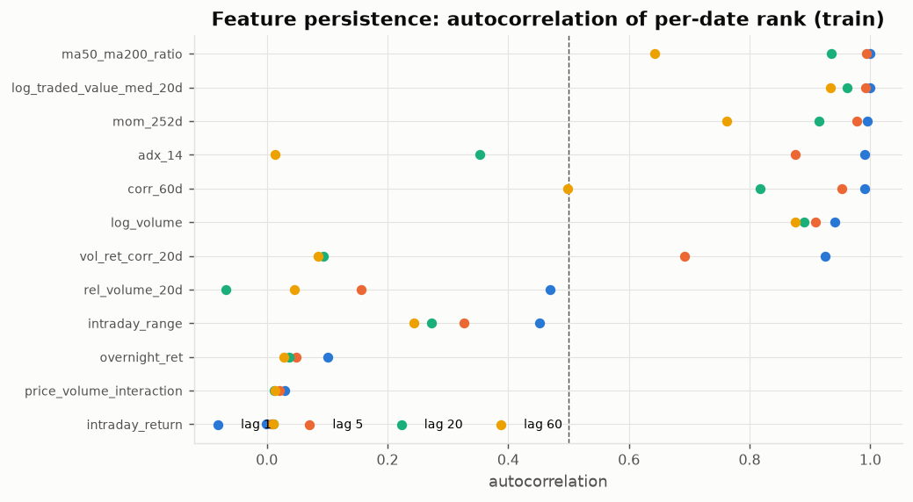
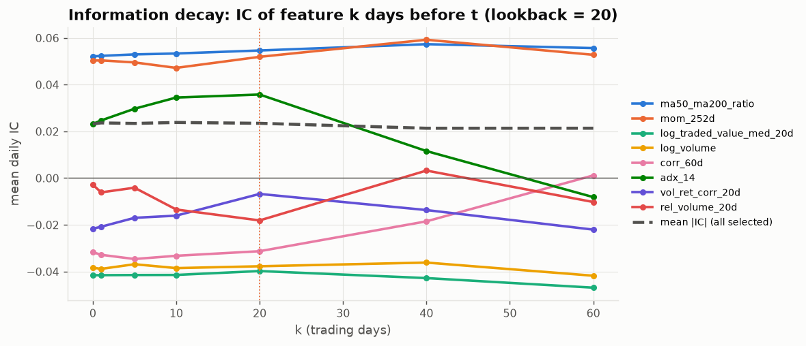
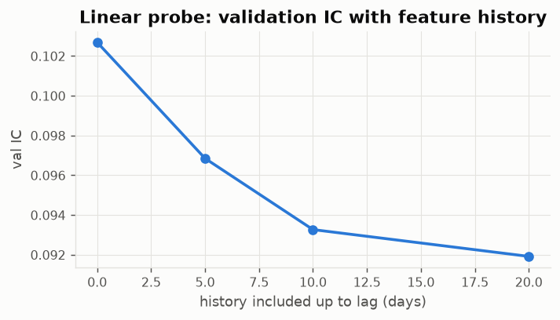

# 05 — RNN — EDA & feature selection

Prerequisite: `00_data_audit/REPORT.md`.

## Why the RNN is prepared this way
- Recurrent nets need **bounded, comparable inputs** → per-date Gaussian rank for stock features (leakage-free, no fitting) and train-fitted z-scores for the market columns.
- A vanilla RNN forgets quickly (vanishing gradients) → **lookback 20 days** and a **small input set** (8 core + up to 4 fast + 3 market) to keep the hidden state's job simple.
- The input is a window, not a snapshot → the EDA below asks which features change over the window (persistence), how far back information reaches (lagged IC), and whether history adds anything (probe).

## Selection

1. Redundancy pruning at |cross-sectional rank corr| ≥ 0.8 → 34 stock features.
2. **Core** = the 8 strongest by |Newey–West IC t| (train): `log_traded_value_med_20d`, `ma50_ma200_ratio`, `vol_ret_corr_20d`, `price_volume_interaction`, `log_volume`, `mom_252d`, `adx_14`, `corr_60d`
3. **Fast** = up to 4 daily-varying features (lag-1 autocorrelation < 0.5) not already in core. Their univariate IC is small, but their *path* over the window (reversal, volume shocks, gaps) is exactly what a recurrent model can use and a cross-sectional model cannot: `intraday_return`, `overnight_ret`, `intraday_range`, `rel_volume_20d`
4. **Market regime** inputs (same for all stocks on a date, z-scored with train statistics): `r_b`, `bench_vol_20d`, `bench_mom_60d`

→ **15 input channels, lookback 20 trading days.**

## Persistence

Slow features (autocorrelation ≈ 1 even at lag 20) repeat almost the same value at every step of a window; they mainly tell the network the current state. Fast features change daily and carry the temporal pattern.



|                          |   lag_1 |   lag_5 |   lag_20 |   lag_60 |
|:-------------------------|--------:|--------:|---------:|---------:|
| log_traded_value_med_20d |   0.999 |   0.992 |    0.962 |    0.934 |
| ma50_ma200_ratio         |   0.999 |   0.994 |    0.936 |    0.642 |
| vol_ret_corr_20d         |   0.926 |   0.692 |    0.094 |    0.085 |
| price_volume_interaction |   0.029 |   0.021 |    0.012 |    0.014 |
| log_volume               |   0.941 |   0.910 |    0.891 |    0.876 |
| mom_252d                 |   0.995 |   0.977 |    0.915 |    0.762 |
| adx_14                   |   0.991 |   0.876 |    0.352 |    0.014 |
| corr_60d                 |   0.990 |   0.952 |    0.818 |    0.499 |
| intraday_return          |  -0.001 |   0.007 |    0.011 |    0.011 |
| overnight_ret            |   0.101 |   0.048 |    0.037 |    0.028 |
| intraday_range           |   0.452 |   0.327 |    0.274 |    0.243 |
| rel_volume_20d           |   0.469 |   0.157 |   -0.068 |    0.046 |

## How far back is there information? (lookback choice)



|                          |       0 |       1 |       5 |      10 |      20 |      40 |      60 |
|:-------------------------|--------:|--------:|--------:|--------:|--------:|--------:|--------:|
| log_traded_value_med_20d | -0.0416 | -0.0416 | -0.0415 | -0.0415 | -0.0398 | -0.0428 | -0.0469 |
| ma50_ma200_ratio         |  0.0520 |  0.0523 |  0.0529 |  0.0533 |  0.0546 |  0.0573 |  0.0556 |
| vol_ret_corr_20d         | -0.0217 | -0.0208 | -0.0170 | -0.0161 | -0.0068 | -0.0137 | -0.0221 |
| price_volume_interaction | -0.0077 | -0.0073 | -0.0052 | -0.0037 | -0.0028 |  0.0003 |  0.0036 |
| log_volume               | -0.0383 | -0.0389 | -0.0369 | -0.0385 | -0.0378 | -0.0362 | -0.0418 |
| mom_252d                 |  0.0503 |  0.0504 |  0.0495 |  0.0472 |  0.0519 |  0.0592 |  0.0528 |
| adx_14                   |  0.0232 |  0.0247 |  0.0297 |  0.0345 |  0.0358 |  0.0116 | -0.0082 |
| corr_60d                 | -0.0317 | -0.0328 | -0.0347 | -0.0333 | -0.0313 | -0.0185 |  0.0011 |
| intraday_return          | -0.0057 | -0.0071 |  0.0028 |  0.0005 | -0.0010 |  0.0040 |  0.0040 |
| overnight_ret            |  0.0027 |  0.0001 | -0.0005 |  0.0001 |  0.0002 |  0.0039 |  0.0046 |
| intraday_range           |  0.0003 |  0.0013 |  0.0059 |  0.0035 |  0.0013 |  0.0053 |  0.0051 |
| rel_volume_20d           | -0.0028 | -0.0061 | -0.0041 | -0.0135 | -0.0181 |  0.0032 | -0.0103 |

## Does feature history add information beyond today's values?

Linear probe (Ridge on today's features plus lagged copies, train → validation). A sequence model should beat the lag-0 row; if history adds nothing linearly, any RNN/LSTM gain must come from non-linear temporal patterns.

|   history up to lag |   inputs |   val IC |   val IC NW t |
|--------------------:|---------:|---------:|--------------:|
|              0.0000 |  12.0000 |   0.1027 |        3.7319 |
|              5.0000 |  24.0000 |   0.0969 |        3.5612 |
|             10.0000 |  36.0000 |   0.0933 |        3.4861 |
|             20.0000 |  48.0000 |   0.0919 |        3.5847 |



## Model-ready dataset (`data/`)

- `X_panel.npy` float32 **[238, 2139, 15]** = [stock, trading day, feature]; zeros where a stock was not listed.
- `targets.npz`: `y_raw, y_win, y_rank, y_class` as [stock, day] (NaN where unavailable) and `present` mask.
- `samples.parquet`: one row per usable (stock, day) — window of 20 listed days fully inside the data; columns `s_idx, t_idx, Date, Symbol, split, has_target, tradable`.
- `meta.json`: feature order, symbols, dates, lookback, train-fitted market scaler.

| split   |   samples |   with_target |
|:--------|----------:|--------------:|
| purge   |      9520 |          9520 |
| test    |    126854 |        122094 |
| train   |    229998 |        229998 |
| val     |     83062 |         83062 |

Load with the ready-made PyTorch dataset:

```python
from dataset import load
train_ds, val_ds, test_ds = load()           # SequenceDataset objects
x, y = train_ds[0]                           # x: [lookback, n_features], y: scalar
```

Windows look back into earlier periods (e.g. a January-2023 validation window uses December-2022 features). That is legitimate — those are past inputs — and the 20-day purge prevents any *target* overlap.