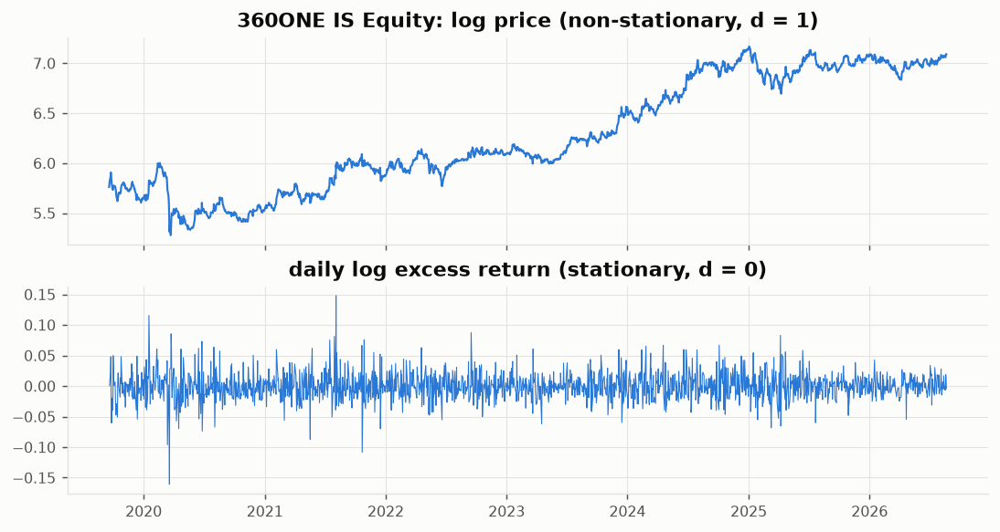
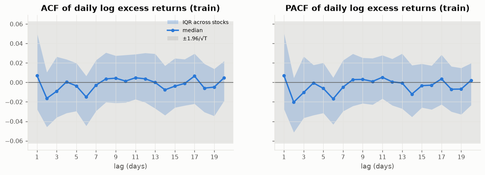
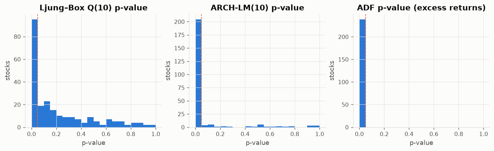
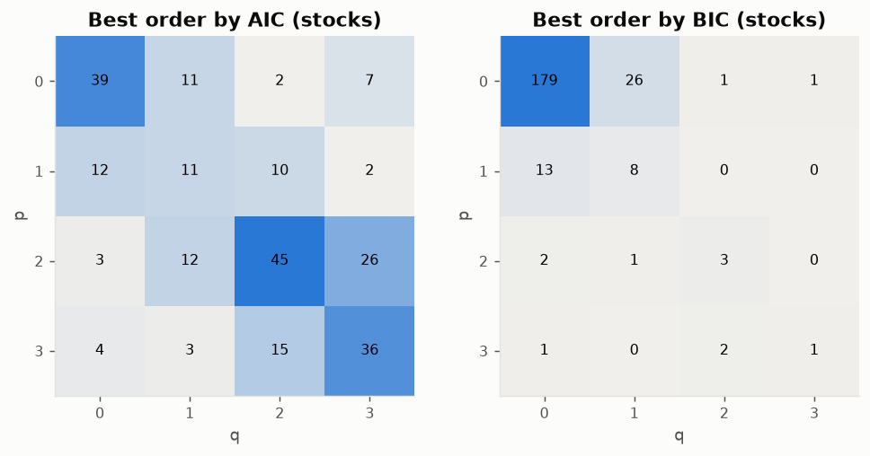

# 07 — ARIMA: EDA & order identification

Prerequisite: `00_data_audit/REPORT.md` (shared splits).

## Why ARIMA is prepared differently
ARIMA is univariate and linear in its own past, so the 50 engineered features do not apply. Its "feature selection" is the choice of series and of (p, d, q):

- **Series**: daily log excess return `e_t = ln(1+r_t) − ln(1+r_bench,t)`. The sum of the next 20 values matches the ML target (Spearman correlation with `target_excess_ret_20d` = **0.999**), so ARIMA forecasts can be ranked and fed to Markowitz exactly like the ML forecasts.
- Everything below uses the **train window (2019–2022)** per stock.

## d — stationarity

|                                  | log price   | log excess return   |
|:---------------------------------|:------------|:--------------------|
| ADF rejects unit root (p<5%)     | 3%          | 100%                |
| KPSS rejects stationarity (p<5%) | 98%         | 4%                  |

Log prices have a unit root, while excess returns are stationary → model returns with **d = 0** (equivalently, ARIMA(p,1,q) on log excess price).

## p, q — autocorrelation structure

- Share of stocks whose ACF is outside ±1.96/√T at lags 1–5: lag 1: 28%, lag 2: 16%, lag 3: 13%, lag 4: 14%, lag 5: 12%.
- Ljung–Box Q(10) rejects 'no autocorrelation' for **40%** of stocks (Q(20): 39%).
- ARCH-LM finds volatility clustering in **86%** of stocks → ARIMA's constant-variance assumption is violated. Use robust standard errors, and consider ARIMA-GARCH as an extension.
- Median excess kurtosis of daily excess returns: 4.7 (fat tails).

### Information-criterion grid p, q ∈ 0…3 (constant included), per stock

Most common BIC orders:

|   bic_p |   bic_q |   stocks |
|--------:|--------:|---------:|
|       0 |       0 |      179 |
|       0 |       1 |       26 |
|       1 |       0 |       13 |
|       1 |       1 |        8 |
|       2 |       2 |        3 |
|       2 |       0 |        2 |

BIC is the recommended criterion (consistent, parsimonious; AIC over-fits with ~1,000 noisy observations). Per-stock orders are in `data/orders.csv` (`recommended_p`, `recommended_q`).

**Key finding:** BIC chooses ARIMA(0,0,0) — white noise plus a constant — for **75%** of stocks (AIC: 16%). For those stocks the 20-day ARIMA forecast is just 20 × the window's mean excess return, i.e. a trailing-drift (momentum) signal. ARIMA is still the right classical benchmark, but when modelling, also compare (a) the BIC orders, (b) the AIC orders and (c) a fixed ARIMA(1,0,1) for every stock, so the benchmark is not reduced to a moving average by construction.

## Model-ready data (`data/`)

- `log_excess_ret_wide.parquet` — the series to model, [date × stock].
- `log_ret_wide.parquet`, `log_price_wide.parquet` — alternatives (raw returns; prices for d = 1).
- `y_raw_wide.parquet` / `y_win_wide.parquet` — the 20d excess-return target from each date, for scoring forecasts.
- `tradable_wide.parquet`, `split_by_date.parquet` — universe flags and the shared splits.
- `orders.csv` — AIC/BIC-best (p, q) per stock; `diagnostics_train.csv` — all test statistics per stock.

Walk-forward use: at each rebalance date t, fit ARIMA(p,0,q) with the stock's recommended order on the last N days of `log_excess_ret` up to t (e.g. N = 500), forecast 20 steps, sum → predicted 20d excess return.