# ML Statistical Arbitrage + Markowitz — Indian equities

**Question:** is a machine-learning forecast a better *expected-return input* to Markowitz portfolio optimisation
than the classic input, each stock's historical mean return?

**Answer (out of sample, Jul 2024 → Aug 2026):** yes. Historical mean returns had no predictive power on the test
period (rank IC 0.0008). All seven ML models had positive IC, up to **0.021 for Random Forest**. Top-10 portfolios built on ML forecasts
beat the same portfolios built on historical means **for every model and for all 20 possible rebalance start
days**. Average Sharpe ratio: about 1.0 for the best ML model, 0.16 for historical means, 0.46 for the market.
The advantage holds in all four portfolio variants (long-only or long-short, 252-day or 20-day lookback). It is
largest for long-short and smallest for long-only with a 20-day lookback, where historical means do much better.

Training steps, server setup and hardware requirements: [TRAINING.md](TRAINING.md).

## Contents

1. [Pipeline at a glance](#pipeline-at-a-glance)
2. [Project layout](#project-layout)
3. [Setup and how to run](#setup-and-how-to-run)
4. [Data, target and splits](#data-target-and-splits)
5. [The seven forecasting models](#the-seven-forecasting-models)
6. [How the models are evaluated (metrics explained)](#how-the-models-are-evaluated-metrics-explained)
7. [Model results](#model-results)
8. [From predictions to a portfolio: top 10 + Markowitz](#from-predictions-to-a-portfolio-top-10--markowitz)
9. [ML vs historical returns: backtest results](#ml-vs-historical-returns-backtest-results)
10. [Allocating a given amount of money](#allocating-a-given-amount-of-money)
11. [Limitations](#limitations)
12. [Explaining the project in short](#explaining-the-project-in-short)
13. [Main EDA findings](#main-eda-findings)

---

## Pipeline at a glance

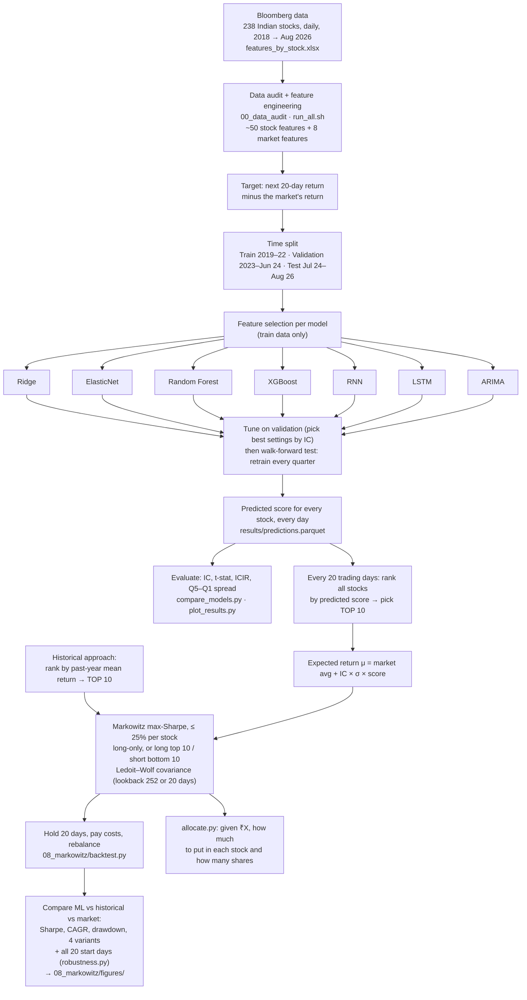

---

## Project layout

```
Implementation/
├── features_by_stock.xlsx      source: 238 stocks × 67 columns, 2018-01 → 2026-08 (Bloomberg, not in git)
├── data/                       shared: panel_raw / panel_clean parquet, IC + correlation tables
├── common/                     shared code: config & splits, transforms, IC tools, extra features, plotting
├── 00_data_audit/              shared EDA: integrity, leakage, target, missingness, IC, redundancy
├── 01_ridge/                   ┐
├── 02_elasticnet/              │  each folder: prepare_data.py → REPORT.md, figures/,
├── 03_random_forest/           │  selected_features.json, data/ (model-ready dataset);
├── 04_xgboost/                 │  train.py → results/ (predictions, metrics, model)
├── 05_rnn/                     │  + dataset.py (PyTorch Dataset)
├── 06_lstm/                    │  + dataset.py (PyTorch Dataset)
├── 07_arima/                   ┘  (per-stock series, orders.csv)
├── 08_markowitz/               backtest.py: top-10 + Markowitz, ML vs historical μ → results/<variant>/
│                               (--side long|longshort, --lookback 252|20)
│                               robustness.py: same backtest for all 20 rebalance start days
│                               plot_backtest.py: every backtest chart → figures/<variant>/, figures/compare/
│                               run_all.sh: all 4 variants + robustness + charts (~1-2 min)
│                               allocate.py: split a given amount of money on the latest date (long or long-short)
│                               optimizer.py: the max-Sharpe solver shared by backtest.py and allocate.py
├── run_all.sh                  rebuilds every dataset (~5 min)
├── train_all.sh                trains all seven models (--quick for a smoke test)
├── compare_models.py           one comparison table from every results/metrics.json → results_summary.md
├── plot_results.py             comparison figures for all models → results_figures/
├── TRAINING.md                 training protocol, per-model steps, GPU server setup, requirements
└── requirements.txt
```

Each model folder has a `REPORT.md` explaining its feature selection. Start with
[00_data_audit/REPORT.md](00_data_audit/REPORT.md).

---

## Setup and how to run

```bash
uv venv .venv --python 3.11 && uv pip install --python .venv/bin/python -r requirements.txt
```

On macOS XGBoost also needs the OpenMP runtime: `brew install libomp`. Python 3.12 works as well.

| step | command | time |
|---|---|---|
| 1. Put `features_by_stock.xlsx` in the repo root (from Bloomberg; not in git) | | |
| 2. Build every dataset | `./run_all.sh` | ~5 min |
| 3. Train all seven models (GPU recommended, see TRAINING.md) | `./train_all.sh` | 1–3 h |
| 4. Model comparison table + figures | `python compare_models.py && python plot_results.py` | < 1 min |
| 5. Markowitz backtests (4 variants), robustness and all charts | `08_markowitz/run_all.sh` | ~1–2 min |
| 6. One variant only | `python 08_markowitz/backtest.py --side longshort --lookback 20` | ~10 s |
| 7. Allocate a given amount of money | `python 08_markowitz/allocate.py --capital 1000000 [--side longshort]` | seconds |

---

## Data, target and splits

**Data.** Daily open/high/low/close/volume for 238 Indian stocks plus a benchmark, January 2018 to 21 August 2026,
with engineered features: momentum (1 to 12 months), volatility, distance from moving averages, volume and liquidity,
beta, and others. Ten more features were added (Amihud illiquidity, Yang–Zhang volatility, RSI, ADX, MFI, CMF, …),
plus 8 market-level "regime" features (index momentum, volatility, drawdown).

**What the models predict.** The return of each stock over the **next 20 trading days minus the benchmark's return**
over the same period (`target_excess_ret_20d`). This is a *relative* forecast: which stocks will beat the others,
not whether the market will rise. That is exactly what is needed to pick a top 10.

**Time split.** Financial data must be split by time, never randomly. Otherwise the model sees the future.

| period | dates | used for |
|---|---|---|
| Burn-in | 2018 | warming up 1-year features (e.g. 12-month momentum) |
| **Train** | 2019 → Dec 2022 | fitting the models, choosing features |
| **Validation** | Jan 2023 → Jun 2024 | choosing each model's hyper-parameters |
| **Test** | Jul 2024 → Aug 2026 | final, honest evaluation, never used for any choice |

A 20-trading-day **purge** gap sits before validation and before test, so no 20-day target window straddles two periods.

**Walk-forward testing.** During the test period every model is **retrained every quarter (63 trading days)** using
only data whose 20-day outcome was already known on the retraining date, then predicts the next quarter. This
mimics how the model would be used in real life.

### Decisions every model shares

| item | choice |
|---|---|
| Target variants | `y_raw` (evaluate / P&L), `y_win` (per-date 1/99% winsorized; default training target), `y_rank` (per-date Gaussian rank), `y_class` (outperform 0/1) |
| Leakage | `fwd_ret_20d`, `bench_fwd_ret`, `target_*` are never features. All selection statistics use train only (plus val for the model-based checks, which is stated where it happens). |
| Scaling | Per-date (cross-sectional) transforms: they use same-day data only, so they need no fitting and carry over to walk-forward unchanged. The only fitted scaler (market columns in RNN/LSTM) uses train statistics. |
| IC t-stats | Newey–West with 20 lags, because daily 20-day targets overlap |
| Extra features | 10 single-stock features from `statarb_features_ranked.pdf` that the file lacked |

---

## The seven forecasting models

| model | type | what it can capture | inputs | features |
|---|---|---|---|---|
| **Ridge** | linear regression with L2 penalty | straight-line relationships; the baseline | stock features, per-date z-scores | 20 |
| **ElasticNet** | linear, L1 + L2 penalty | like Ridge, but also switches off useless features | stock features | 39 (13 stable) |
| **Random Forest** | average of 500 decision trees | non-linear effects and interactions (e.g. momentum works only in calm markets) | stock ranks + market regime | 19 |
| **XGBoost** | gradient-boosted trees | as Random Forest, built sequentially; handles missing values | stock ranks + market regime, NaN kept | 27 |
| **RNN** | recurrent neural network | patterns in the last 20 days of each feature | 20-day windows | 15 × 20 steps |
| **LSTM** | long short-term memory network | longer patterns (60 days) | 60-day windows | 22 × 60 steps |
| **ARIMA** | classical time-series model, one per stock | a stock's own past returns only | daily excess returns | per-stock orders |

### Per-model preparation

| model | transform | selection method | quick val IC* |
|---|---|---|---|
| Ridge | per-date winsorize + z-score | IC screen → decorrelate (0.8) → VIF < 5 | 0.105 |
| ElasticNet | per-date winsorize + z-score | remove near-duplicates (0.9); stability selection as diagnostic | 0.089 |
| Random Forest | per-date rank; market raw | Boruta-style shadows + validation permutation IC | 0.083 |
| XGBoost | per-date rank, **NaN kept** | mean \|SHAP\| (95%) + validation permutation IC | 0.089 |
| RNN | per-date Gaussian rank; market train z-score | 8 IC core + 4 fast daily + 3 market | — |
| LSTM | as RNN | 14 IC core + 3 fast daily + 5 market | — |
| ARIMA | daily log excess return | ADF/KPSS → d = 0; ACF/PACF, Ljung–Box, BIC grid for (p, q) | — |

\* Mean daily rank IC on validation from an *untuned* default model, used only to sanity-check each feature set.

Every model follows the same protocol (details in [TRAINING.md](TRAINING.md)): tune on validation → pick the
settings with the highest validation IC → walk-forward over test → save `results/predictions.parquet`,
`metrics.json`, `tuning.csv`.

---

## How the models are evaluated (metrics explained)

### Information Coefficient (IC): the main metric

On each day:
1. the model gives every stock a score (its predicted 20-day excess return);
2. 20 days later we see what each stock actually returned;
3. the **Spearman rank correlation** between the predicted ranking and the actual ranking is that day's IC.

"Mean IC" is the average over all days.

| IC | meaning |
|---|---|
| 1 | perfect ranking |
| 0 | no better than random |
| < 0 | ranking is backwards |
| **0.02 – 0.05** | **typical useful signal in practice**; 0.10 is excellent |

We use *rank* correlation because the strategy only needs the **order** of stocks (buy the best-ranked), not the
exact return.

### Other metrics

| metric | what it answers | rule of thumb |
|---|---|---|
| **Newey–West t-stat** | is the mean IC really above zero, or luck? Newey–West corrects for overlapping 20-day returns on consecutive days | > 1.96 = significant at 5% |
| **ICIR** | how *consistent* is the signal? mean IC ÷ std of IC, annualised. Similar to a Sharpe ratio for the signal | higher = steadier |
| **IC hit rate** | % of days with IC > 0 | > 50% = right more often than wrong |
| **Q5–Q1 spread** | each day: average actual return of the top 20% predicted stocks minus the bottom 20%. A simple long–short portfolio, before costs | positive and significant = the model separates winners from losers |
| **Sharpe ratio** (portfolio) | return per unit of risk: annual return ÷ annual volatility | > 1 is good |
| **CAGR** | compound annual growth rate of the portfolio | |
| **Max drawdown** | worst peak-to-trough loss | smaller is better |
| **Turnover** | fraction of the portfolio traded at each rebalance | drives trading costs |

**Validation vs test.** Validation numbers were used to *choose* each model's settings, so they are optimistic.
**Test numbers are the honest ones**; all conclusions are based on them.

---

## Model results

Out-of-sample (test, Jul 2024 → Aug 2026, walk-forward). Full table: `results_summary.md`.

| model | val IC | **test IC** | test t | test ICIR | IC > 0 days | Q5–Q1 ann. (gross) | Q5–Q1 t |
|---|---|---|---|---|---|---|---|
| **Random Forest** | 0.094 | **0.0208** | 0.98 | **0.57** | 56.5% | 16.6% | 2.58 |
| XGBoost | 0.096 | 0.0183 | 0.83 | 0.48 | 54.2% | 16.8% | 2.61 |
| LSTM | 0.097 | 0.0137 | 0.74 | 0.41 | 55.4% | 12.2% | 2.20 |
| Ridge | 0.105 | 0.0100 | 0.64 | 0.33 | 54.8% | 11.8% | 2.26 |
| RNN | 0.108 | 0.0092 | 0.53 | 0.29 | 53.4% | 12.9% | 2.48 |
| ARIMA | 0.079 | 0.0072 | 0.29 | 0.17 | 57.3%† | 5.0% | 0.68 |
| ElasticNet | 0.107 | 0.0038 | 0.20 | 0.11 | 55.6% | 9.2% | 1.59 |

† ARIMA is evaluated on every 5th day only (103 dates), the others on 513 dates.

**How to read this:**
- **Tree models (Random Forest, XGBoost) are best out of sample.** They capture non-linear effects and
  interactions with the market regime.
- **IC drops sharply from validation (~0.10) to test (~0.01–0.02).** 2023 was an easy year, and settings chosen on
  validation are optimistic. In **2025 every model's IC was close to zero**: the market regime changed.
- **No model's mean IC is significant on its own (t < 1.96)**, but the **Q5–Q1 spread is significant (t > 1.96) for
  five models**. The models reliably separate the best stocks from the worst, which is what a top-10 strategy uses.
- Ridge and ElasticNet scored *highest* on validation but among the lowest on test: a classic sign of overfitting
  to the validation period.

### Figures (`results_figures/`, made by `plot_results.py`)

| figure | what it shows |
|---|---|
| `01_val_vs_test_ic.png` | validation vs test IC on the same scale: the drop |
| `02_test_tstats.png` | IC and Q5–Q1 t-stats against the 1.96 significance line |
| `03_test_economics.png` | annualised Q5–Q1 spread, ICIR, % of days with IC > 0 |
| `04_cumulative_ic.png` | running sum of daily IC: a rising line = the signal keeps working |
| `05_ic_by_year.png` | IC per year: strong 2023, near zero in 2025, recovery in 2026 |
| `06_tuning_spread.png` | validation IC of every hyper-parameter setting tried vs the test IC of the winner |

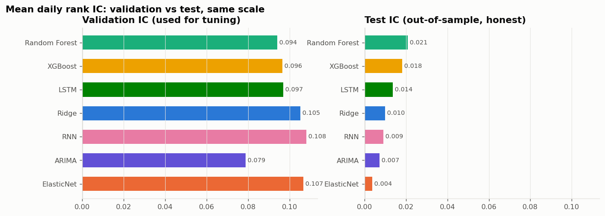
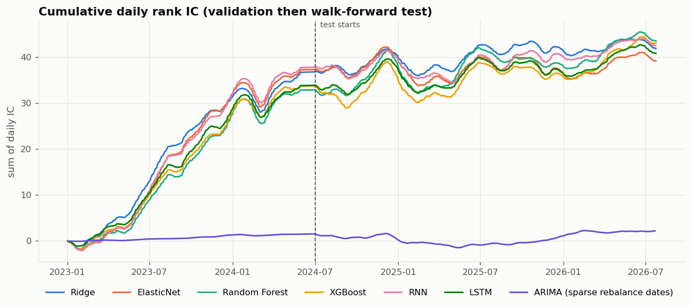

---

## From predictions to a portfolio: top 10 + Markowitz

`08_markowitz/backtest.py` runs two pipelines side by side, identical except for the expected-return input.
Steps 4–5 and the lookback have two settings each, giving **four variants**; the portfolio stage uses the models'
saved predictions, so no retraining is needed to run any of them.

| setting | options | flag |
|---|---|---|
| Portfolio side | **long-only** (buy top 10) or **long–short** (buy top 10, short bottom 10, dollar-neutral) | `--side long` / `--side longshort` |
| Lookback for historical μ, σ and the covariance | **252 days** (1 year) or **20 days** (1 month) | `--lookback 252` / `--lookback 20` |

**Why 252 days is the main lookback** (for both long-only and long–short):
- 252 trading days = 1 year, the standard estimation window for risk models and the classic definition of the
  historical-mean input, which makes it the fair baseline.
- The covariance needs enough data: long–short Markowitz on 20 stocks estimates 210 variances and covariances.
  One year of daily returns supports that; 20 days does not, and the matrix becomes mostly shrinkage.
- A year spans different market conditions, so volatility and correlation estimates are not driven by one month.

The 20-day lookback is a robustness check: it reacts faster but is much noisier. ML beats historical μ with both.

### Step 1: rebalance every 20 trading days

Over the test period (1 Jul 2024 → 21 Aug 2026): 27 rebalances, matching the 20-day forecast horizon.

### Step 2: estimate each stock's expected return μ

| approach | expected 20-day return μ |
|---|---|
| **Historical** (classic Markowitz) | each stock's average daily return over the lookback window (252 or 20 days) × 20 |
| **ML** (Grinold–Kahn) | **μᵢ = μ̄ + IC × σᵢ × zᵢ** |

where
- **μ̄** = the average historical μ across all stocks, the same market drift for both approaches;
- **zᵢ** = the model's score for stock *i*, as a per-date normal score (0 = average, +2 = very strong);
- **σᵢ** = the stock's 20-day volatility of excess return (over the lookback window);
- **IC** = the model's own realised IC over the last 252 prediction dates whose outcome was already known
  (floored at 0). An inaccurate model gets a small IC and its forecasts are shrunk towards the market average.

This is the standard "alpha = IC × volatility × score" rule from Grinold & Kahn's *Active Portfolio Management*.

### Step 3: pick the top 10 (and, for long–short, the bottom 10)

Rank every tradable stock by its score: historical μ, or the ML model's prediction. Take the **10 highest** to buy.
In the long–short variant also take the **10 lowest** to short.

### Step 4: decide how much goes into each (two methods)

Both start from the **same 10 stocks**; only the split differs.

**EW (Equal Weight):** 10% in each stock. It ignores risk and correlations, so it measures purely whether the model
**picks** good stocks.

**MV (Markowitz mean–variance, max-Sharpe):** choose weights *w* to maximise

$$\text{Sharpe}(w) = \frac{w^\top \mu}{\sqrt{w^\top \Sigma\, w}} \quad \text{subject to } \sum_i w_i = 1,\; 0 \le w_i \le 0.25$$

- **Σ** = covariance of the stocks' daily returns over the lookback window, with **Ledoit–Wolf shrinkage**
  (a raw sample covariance is noisy and makes Markowitz unstable, especially with only 20 days of data).
- **Long-only** (wᵢ ≥ 0): only buying, no short selling.
- **Long–short:** longs wᵢ ≥ 0 summing to +1, shorts wᵢ ≤ 0 summing to −1 (|wᵢ| ≤ 25%). The portfolio is
  **dollar-neutral**: ₹1 long and ₹1 short per ₹1 of capital, so the market's moves largely cancel and the return
  comes from the spread between winners and losers. Equal weight is +10% in each long and −10% in each short.
- **Cap 25%** per stock: without it Markowitz puts most of the money into one or two stocks, because it trusts its
  noisy estimates too much.

In practice MV gives **more money** to stocks with a higher expected return, lower volatility, or low correlation
with the rest (diversifiers), and **less or zero** to stocks that move together with ones already held. In the
latest allocation, for example, 6 of the 10 picks were financials. MV shifted money into the two healthcare stocks
and gave 0% to one financial stock that only added correlated risk.

If no stock has a positive μ, MV falls back to the minimum-variance portfolio. This never happened in the main test run.

### Step 5: hold, pay costs, repeat

Hold for 20 trading days (weights drift with prices), pay **10 bps** per unit of one-way turnover, rebalance.
Long–short has no extra borrowing cost; in India a 20-day short needs stock futures or securities lending, which
would cost somewhat more.
Nothing uses future data: inputs at date T use data up to T's close, and returns are earned from T+1.

---

## ML vs historical returns: backtest results

### Main variant: long-only, 252-day lookback (start 1 Jul 2024, net of 10 bps costs)

| expected-return input | daily test IC of the input | EW Sharpe | **MV Sharpe** | MV CAGR | MV max DD |
|---|---|---|---|---|---|
| **Historical mean** | **0.0008** (t = 0.03) | 0.45 | **0.46** | 9.5% | −29.5% |
| Ridge | 0.0100 | 0.87 | 0.81 | 17.9% | −27.1% |
| ElasticNet | 0.0038 | 1.23 | 1.33 | 34.2% | −18.7% |
| Random Forest | 0.0208 | 1.12 | 0.92 | 19.5% | −22.0% |
| XGBoost | 0.0183 | 1.08 | 0.74 | 15.4% | −28.1% |
| RNN | 0.0092 | 1.17 | 1.20 | 29.0% | −18.0% |
| LSTM | 0.0137 | 1.10 | 0.95 | 21.2% | −25.2% |
| ARIMA | 0.0072 | 0.53 | 0.80 | 18.9% | −26.7% |
| Benchmark (market) | – | – | 0.51 | 7.6% | −20.1% |

### Robustness: all 20 possible start days (long-only, 252-day lookback)

With only 27 rebalances, one start day can be lucky or unlucky. `robustness.py` re-runs everything starting on
each of the 20 days of the first cycle.

| strategy | mean Sharpe | worst Sharpe | mean CAGR | Sharpe > historical |
|---|---|---|---|---|
| **Random Forest EW** | **1.04** | 0.76 | 24.3% | **20 / 20** |
| Ridge MV | 1.02 | 0.67 | 24.0% | 20 / 20 |
| XGBoost EW | 1.00 | 0.79 | 23.7% | 20 / 20 |
| RNN EW | 1.00 | 0.49 | 23.6% | 20 / 20 |
| … every other ML strategy | 0.31 – 0.98 | | | 19–20 / 20 |
| Benchmark | 0.46 | 0.40 | 6.8% | |
| **Historical MV** | **0.16** | −0.26 | 0.8% | – |
| **Historical EW** | **0.16** | −0.21 | 0.6% | – |

Full tables per variant: `08_markowitz/results/<variant>/summary.md` and `offset_robustness.md`; all variants in
one table: `08_markowitz/results/variant_summary.md`.

### All four variants

Markowitz (MV) portfolios. "ML average" is an equal blend of the seven ML portfolios, so no model is picked with
hindsight. Mean Sharpe is over the 20 start days.

| variant | Historical μ Sharpe | ML average Sharpe | Historical μ CAGR | ML average CAGR | ML beats historical (models × weightings × start days) |
|---|---|---|---|---|---|
| **Long-only, 252-day** | 0.46 (mean 0.16) | **1.07** (mean 0.81) | 9.5% | **22.8%** | 279 / 280 |
| Long-only, 20-day | 1.01 (mean 0.75) | **1.27** (mean 0.92) | 23.9% | **29.5%** | 198 / 280 |
| **Long–short, 252-day** | 0.37 (mean −0.01) | **1.43** (mean 1.09) | 6.1% | **23.9%** | 276 / 280 |
| Long–short, 20-day | 0.56 (mean 0.29) | **1.47** (mean 1.01) | 10.8% | **26.6%** | 250 / 280 |
| Benchmark (market) | 0.51 (mean 0.46) | | 7.6% | | |

What changes across variants:
- **Long–short shows the ML advantage most clearly.** Shorting the ML's bottom 10 removes most market risk
  (volatility ~16% vs ~21%, max drawdown −16% vs −23%) and the ML average Sharpe rises to ~1.4. The historical
  long–short barely makes money: its "losers" keep losing no more than its "winners" keep winning.
- **Most of the long–short gain comes from the long leg.** The ML short leg loses slightly overall (about −5%
  cumulative, `figures/longshort_lb252/12_long_vs_short_leg.png`): the models are better at finding winners than
  losers, and the short leg mainly serves as a market hedge.
- **A 20-day lookback makes historical μ much better in long-only** (Sharpe 1.01 vs 0.46). A 1-month average return
  is a short-term momentum signal that happened to work in this period. ML is still ahead (Sharpe 1.27; input IC up to
  0.021 vs 0.005 for the 20-day mean), but the gap is small and ML wins only 198 of 280 comparisons.
  It also trades far more: ~180% turnover per rebalance for historical μ.
- **The 20-day lookback hardly changes the ML portfolios**: the ML ranking does not depend on the lookback, only
  the covariance and σ do. Equal-weight ML results are identical across lookbacks.

### Charts (`08_markowitz/figures/`, made by `plot_backtest.py`)

Each variant folder (`long_lb252`, `long_lb20`, `longshort_lb252`, `longshort_lb20`) has:

| figure | what it shows |
|---|---|
| `01_equity_curves.png` | growth of 1 for every model, historical μ, ML average and the market; Markowitz and equal weight |
| `02_drawdowns.png` | drawdown from the previous peak over time (underwater chart) |
| `03_ml_vs_historical.png` | ML average with the range of the 7 models vs historical μ |
| `04_rolling_sharpe.png` | 6-month rolling Sharpe: when each approach worked |
| `05_period_return_distribution.png` | spread of the 20-day returns per source (box plot) |
| `06_expected_vs_realised.png` | the μ fed to Markowitz vs what the portfolio actually earned: historical μ is far too optimistic |
| `07_annual_returns.png` | return per calendar year for every source (heatmap) |
| `08_risk_return.png` | volatility vs CAGR for every strategy |
| `09_robustness_start_days.png` | Sharpe over the 20 start days (box plot) |
| `10_turnover_diversification.png` | average turnover and effective number of positions |
| `11_ml_minus_historical_by_period.png` | ML average minus historical return in each 20-day period |
| `12_long_vs_short_leg.png` | long-short only: return from the long leg vs the short leg |

`figures/compare/` sets the variants side by side:

| figure | what it shows |
|---|---|
| `A_sharpe_by_variant.png` | Sharpe of historical μ, ML and the market in every variant (mean ± sd over start days) |
| `B_share_of_start_days_beating_historical.png` | per model and variant: share of start days on which ML beats historical |
| `C_sharpe_gap_vs_historical.png` | per model and variant: Sharpe of ML minus Sharpe of historical |
| `D_cagr_and_drawdown_by_variant.png` | CAGR and maximum drawdown per variant |
| `E_equity_all_variants.png` | ML average vs historical μ growth curves, all four variants |

#### All variants side by side

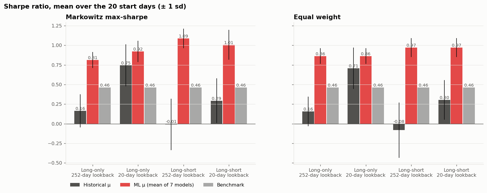
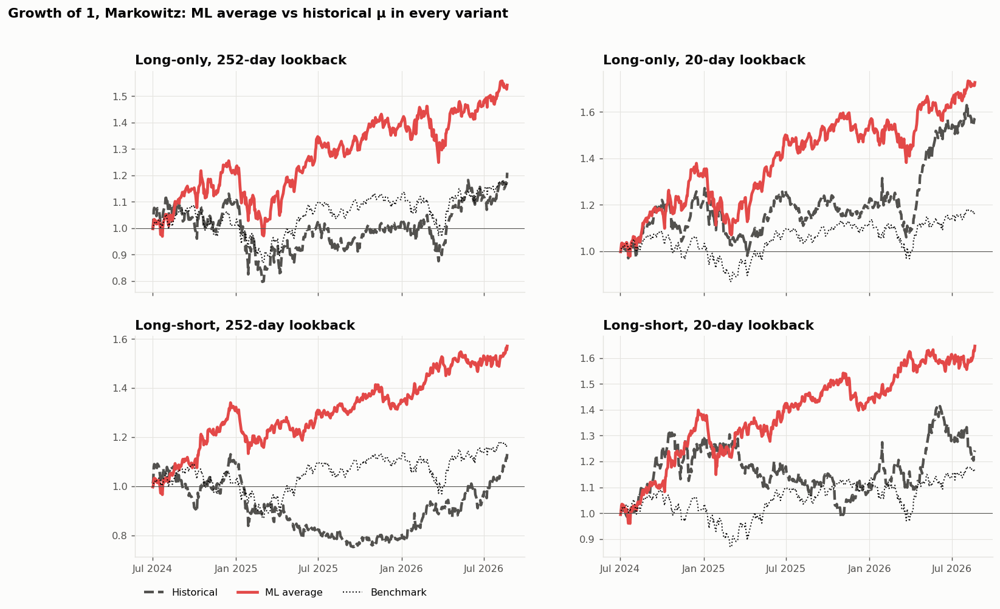

The same three charts for every variant: ML vs historical growth, drawdowns, and expected vs realised return.

#### Long-only, 252-day lookback

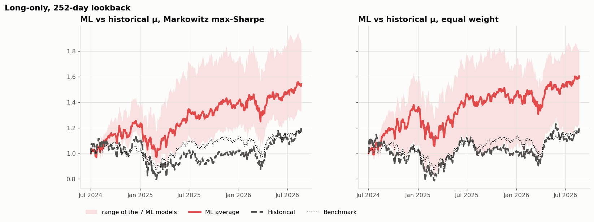
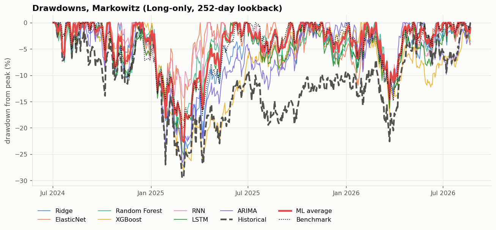
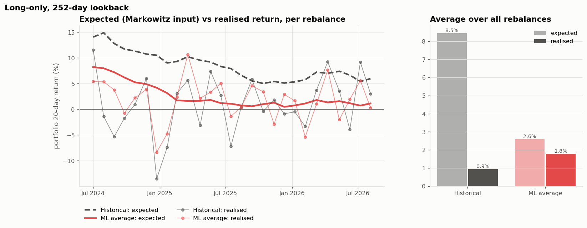

#### Long-only, 20-day lookback

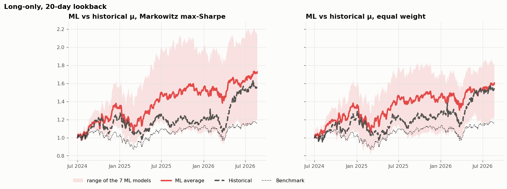
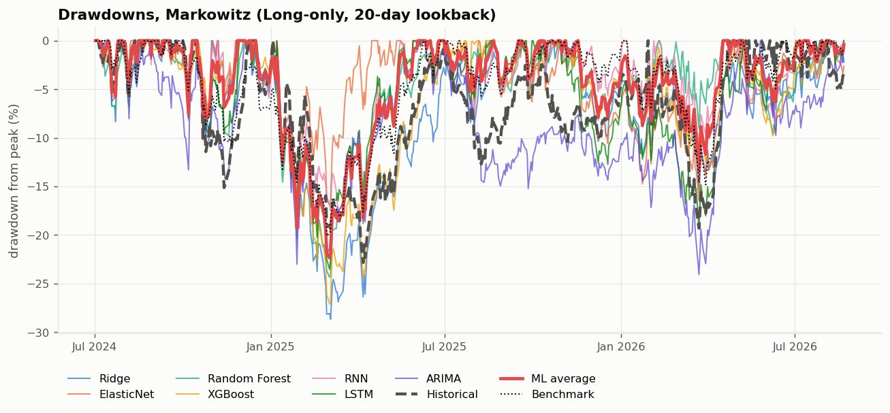
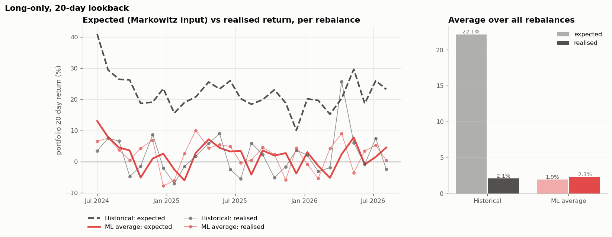

#### Long–short, 252-day lookback

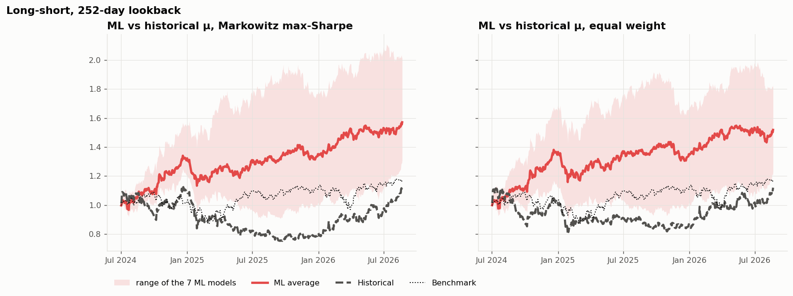
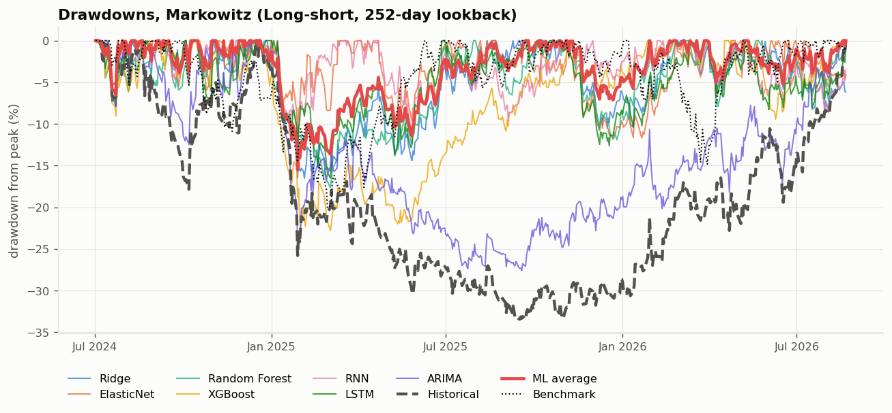
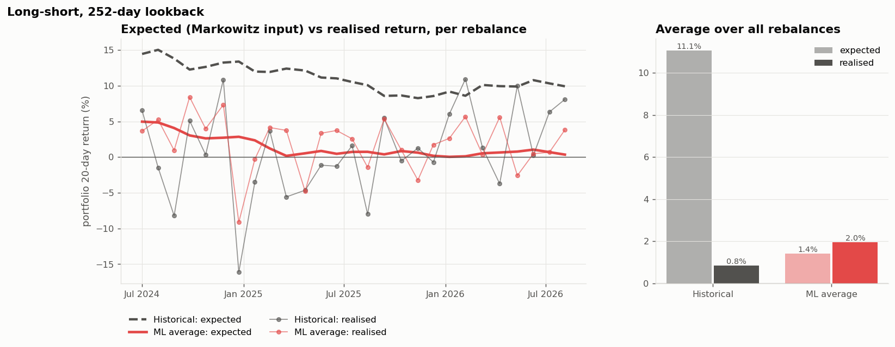

#### Long–short, 20-day lookback

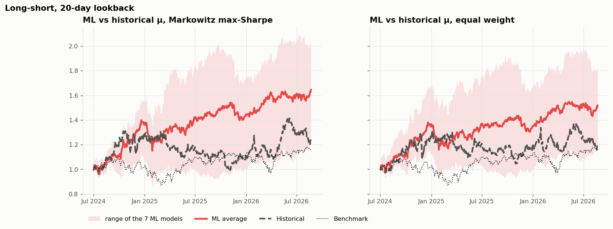
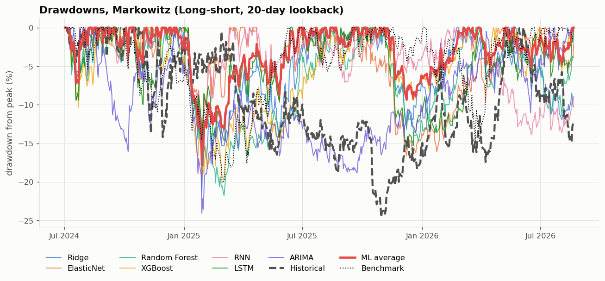
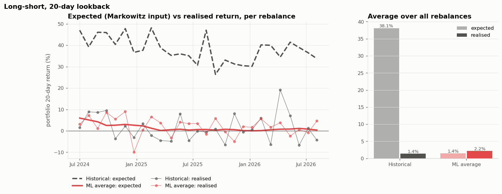

### Conclusions

1. **The ML input is a better forecast.** On test, historical mean returns predict future returns no better than
   chance (IC 0.0008). Every ML model has a higher IC.
2. **Historical means are overconfident.** For the historical top 10, μ is typically 5–7% per 20 days (~100% a
   year): these are last year's biggest winners, which do not keep winning. ML μ is a realistic ~1% per 20 days.
   Markowitz is known to amplify estimation errors, and historical means feed it exactly those.
3. **The advantage is robust.** Across 7 models × 2 weightings × 20 start days, the ML portfolio has the higher
   Sharpe in 279 of 280 comparisons.
4. **Best model: Random Forest.** Highest test IC, highest ICIR, highest average Sharpe across start days, and beats
   historical on every start day. ElasticNet's top Sharpe in the single run is luck: its IC is close to zero and its
   result swings with the start day.
5. **It holds in every variant.** ML beats historical μ for long-only and long–short, with 252-day and 20-day
   lookbacks. The gap is largest for long–short and smallest for long-only with a 20-day lookback.
6. **Markowitz adds little on top of ML picks.** The ML μ values are close together, so MV mainly manages risk; EW
   was as good or better for most models. The gain comes from *which* stocks are picked.

---

## Allocating a given amount of money

`08_markowitz/allocate.py` applies the same recipe once, on the latest date in the data, and converts the weights
into rupees and whole shares at the latest close. It uses the same max-Sharpe solver as the backtest
(`optimizer.py`), with a 252-day lookback. The result is saved to `08_markowitz/results/allocation_<side>.csv`,
one row per stock with its side (`long`/`short`), action (`BUY`/`SHORT`), weight, amount, price, shares, value and
expected 20-day return. Shorts have negative weights, amounts and share counts.

```bash
python 08_markowitz/allocate.py --capital 1000000                                  # ₹10 lakh, long-only
python 08_markowitz/allocate.py --capital 1000000 --side longshort                 # ₹10 lakh long + ₹10 lakh short
python 08_markowitz/allocate.py --capital 500000 --model 04_xgboost --top 15 --cap 0.2
```

Example output for ₹10,00,000 with Random Forest on 21 Aug 2026 (the last date in the data), **long-only**:

| stock | weight | amount (₹) | price (₹) | shares |
|---|---|---|---|---|
| ASTERDM | 22.1% | 2,20,850 | 761.55 | 290 |
| DLPL | 21.1% | 2,10,256 | 1,894.20 | 111 |
| CGCL | 12.8% | 1,28,145 | 224.03 | 572 |
| CREDAG | 11.4% | 1,13,704 | 1,496.10 | 76 |
| KVB | 8.4% | 83,540 | 335.50 | 249 |
| ARTO | 8.0% | 79,607 | 527.20 | 151 |
| AEGISLOG | 6.3% | 62,388 | 1,417.90 | 44 |
| CUBK | 6.2% | 62,365 | 217.30 | 287 |
| POONAWAL | 3.6% | 35,774 | 490.05 | 73 |

Invested ₹9,96,628, cash left ₹3,372. Expected 20-day return +1.14%, 20-day volatility 5.1%.

**Long–short** (`--side longshort`), same capital and date: buy ₹10 lakh of the top 10 and short ₹10 lakh of the
bottom 10 (dollar-neutral, gross exposure ₹20 lakh, |weight| ≤ 25%):

| side | stock | weight | shares |
|---|---|---|---|
| long | DLPL | +18.9% | 99 |
| long | ARTO | +12.7% | 241 |
| long | MOFS | +11.1% | 112 |
| long | KVB | +10.5% | 311 |
| long | CREDAG | +9.1% | 60 |
| long | CGCL | +8.5% | 379 |
| long | ASTERDM | +7.8% | 103 |
| long | AEGISLOG | +7.7% | 53 |
| long | CUBK | +7.5% | 344 |
| long | POONAWAL | +6.1% | 125 |
| short | HDFCLIFE | −19.1% | −344 |
| short | GCPL | −16.0% | −171 |
| short | TMPV | −14.3% | −448 |
| short | HPCL | −13.7% | −378 |
| short | JUBI | −13.6% | −268 |
| short | TCS | −11.1% | −48 |
| short | KPITTECH | −10.0% | −169 |
| short | INFO | −2.2% | −19 |

Bought ₹9,94,071, sold short ₹9,97,318 (net exposure −₹3,247). Two of the bottom 10 got 0% and are not shorted.
Expected 20-day return +0.31% with 20-day volatility 4.6%: lower than long-only because the market drift cancels
between the two legs, leaving only the spread between the model's winners and losers. A 20-day short in India
needs stock futures or securities lending.

**Why only one date?** The data ends on 21 Aug 2026 and each forecast covers the next 20 trading days only. For a
current allocation: export fresh data → `./run_all.sh` → retrain the model → run `allocate.py`; repeat every 20
trading days. The picks and weights at every past rebalance are in `08_markowitz/results/<variant>/holdings.csv`:

| column | meaning |
|---|---|
| `Date` | rebalance date; formed at that day's close, held 20 trading days |
| `source` | where μ came from: `Historical` or a model name |
| `weighting` | `EW` (equal weight) or `MV` (Markowitz max-Sharpe) |
| `side` | `long` (top 10) or `short` (bottom 10, long–short variants only) |
| `Symbol` | Bloomberg ticker |
| `weight` | fraction of capital in this stock: longs sum to 1, shorts to −1; 0 = picked but not held |
| `mu_20d` | expected 20-day return fed to Markowitz |
| `score` | value used to rank and pick the top 10 (historical: same as `mu_20d`; ML: model score z) |

This is a research backtest for a course project, **not investment advice**.

---

## Limitations

- **Short test period.** About 2 years (27 rebalances), including 2025 when every model's signal faded. Per-model
  differences against historical are not individually significant (paired t-stats 0.4–1.5). The evidence is the
  consistency across models, weightings and start days.
- **Survivorship bias.** The universe is today's 238 stocks applied back in time. Firms that collapsed or were
  delisted are missing, which flatters every strategy, especially small/mid-cap tilts.
- **Trading costs.** Long-only ML portfolios replace about 90–110% of holdings per rebalance (~11× a year);
  long–short about 200–250% (two legs). 10 bps is included. At a more realistic 30 bps for mid caps, expect roughly
  2–2.5% a year less for long-only and about twice that for long–short.
- **Shorting.** The long–short variants assume shorts can be held for 20 days at no extra cost. In India that needs
  stock futures (only for F&O stocks) or securities lending, both of which cost more.
- **Selection after the fact.** Naming the best model on test adds optimism. The average across all ML models
  (Sharpe ~0.86) is the more conservative figure.
- **Corporate actions.** Two unadjusted demergers (Siemens 2025-04, Tata Motors 2025-10) show as fake price
  jumps; daily moves above 35% are set to 0 in the backtest.

---

## Explaining the project in short

**One line:**
> The ML model ranks 238 stocks every month by predicted outperformance. We buy the top 10, weight them with
> Markowitz, and out of sample this beat the classic historical-return approach in every test we ran.

**30 seconds:**
> We trained machine-learning models to predict which stocks will outperform the market over the next 20 trading
> days, using momentum, volatility, liquidity, trend and market-condition features. Every 20 days the model scores
> all 238 stocks, we take the top 10, and Markowitz decides how much goes into each. We compared 7 models and chose
> Random Forest: it had the best out-of-sample prediction accuracy (IC 0.021) and the most consistent portfolio
> (average Sharpe 1.04, against 0.16 using historical returns and 0.46 for the market).

**Common questions:**

| question | answer |
|---|---|
| What does the model predict? | Each stock's 20-day return minus the market's: a relative ranking, not a market call. |
| How did you avoid cheating? | Time-based split, 20-day purge gaps, test data never used for any choice, quarterly walk-forward retraining on past data only. |
| How do you know it works? | Test IC 0.021 vs 0.0008 for historical means; significant Q5–Q1 spread (t = 2.58); beats historical on all 20 start days. |
| Isn't IC 0.02 tiny? | Stock returns are mostly noise; 0.02–0.05 is a useful signal in practice. A small edge over many stocks and months adds up. |
| Why Random Forest, not deep learning? | Trees were best out of sample. RNN/LSTM looked good on validation but dropped more on test; past feature history added little information. |
| How do predictions become a top 10? | Rank all stocks by predicted score, take the top 10, convert scores to expected returns with μ = μ̄ + IC × σ × z, then Markowitz. |
| What are the limitations? | Short test, survivorship bias, results not individually significant. Robustness comes from consistency across every variant. |

---

## Main EDA findings

- The signal is weak but real. The best single features have train IC ≈ 0.04–0.05 (NW t ≈ 2–2.7). They are size/liquidity
  (smaller, less liquid names outperform: `log_traded_value_med_20d`, `amihud_log_20d`) and long-horizon trend
  (`mom_252d`, `ma50_ma200_ratio`, `dist_ma200`). Short-term reversal is weak.
- Feature relevance shifts with market volatility (see `03_random_forest/figures/04_regime_ic.png`). This is why the
  tree and sequence models get market-regime inputs.
- Adding lagged feature values does not raise validation IC linearly (RNN/LSTM reports). Any RNN/LSTM gain must come
  from non-linear temporal patterns.
- Daily excess returns are close to white noise: BIC picks ARIMA(0,0,0) for 76% of stocks.
- Data caveats: unadjusted demergers (Siemens 2025-04, Tata Motors 2025-10) and survivorship (today's universe
  back-filled) → winsorized targets for training; results will be somewhat optimistic.

### Loading a dataset

```python
import pandas as pd, json
df = pd.read_parquet("01_ridge/data/ridge_dataset.parquet")
feats = json.load(open("01_ridge/selected_features.json"))["features"]
tr = df[(df.split == "train") & df.has_target]
X, y = tr[feats], tr.y_win
```
